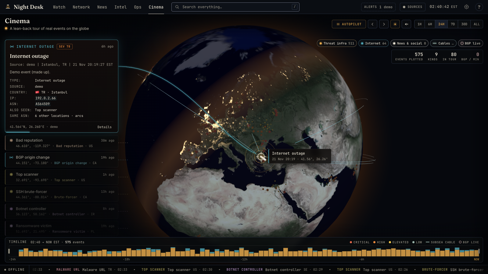

# Night Desk

**A threat desk for your home network: it checks what your devices talked to against the threat feeds as they were at that moment, on one machine you own, with no cloud and no account.**

> **Pre-alpha (v0.1.0).** It works, it has rough edges, and your feedback shapes what comes next: [open an issue](#feedback-and-problems).



<sub>Cinema, the lean-back globe view, shown here with made-up demo events.</sub>


## Start it

Requires one of:

- **Docker with Compose,** and port 443 or one of 8443–8449 free. Tested on macOS; Linux should work, and on Windows it runs inside WSL (not tested yet).
- **[uv](https://docs.astral.sh/uv/getting-started/installation/) 0.12.19 or newer** (it fetches Python 3.14 if you don't have it), on macOS or Linux, with port 8787 free.

Pick one line and paste it into a terminal. Everything stays on your machine, and nothing is sent as telemetry.

**Try it with demo data.** It opens in your browser: choose **Network › Demo**. Ctrl+C stops it, and `rm -rf /tmp/nightdesk-try` removes it.

```sh
uvx --from git+https://github.com/MrAndrew/nightdesk@v0.1.0-prealpha nightdesk --offline --open --lake /tmp/nightdesk-try
```

**Run it on this computer, without Docker.** It opens http://127.0.0.1:8787. The first start downloads about 140 MB of reference data.

```sh
uvx --from git+https://github.com/MrAndrew/nightdesk@v0.1.0-prealpha nightdesk --open
```

**Install it with Docker, with HTTPS.** It asks three questions, each with a default: where to keep the data, who can open it, and whether to trust its certificate. Then it builds Night Desk, starts it and opens https://nightdesk.localhost. The first build takes a few minutes.

```sh
curl -fsSL https://github.com/MrAndrew/nightdesk/releases/latest/download/install.sh | sh
```

Add `-s -- --yes` after `sh` to take every default, and `--lan` too to open it from your phone and other devices on your network (it makes a password and prints it once). The script is short and readable: [`deploy/install.sh`](deploy/install.sh). Every option is in the [deployment guide](okf/architecture/deployment.md#one-line-install-docker).

## What it does

At its core, Night Desk is an OSINT (open-source intelligence) analysis tool that works with your own network logs. That makes it easier to match your network's activity against known threats, by hand and automatically. It reads Zeek and Suricata logs (from your own sensor, Security Onion, OPNsense or pfSense) and Pi-hole and AdGuard Home DNS logs.

It answers one question: *what touched my network, and was it bad at the time?*

- **It judges each connection by the threat lists as they were at that moment.** An address cleaned up since doesn't raise a false alarm, and one that was bad when your laptop reached it isn't forgotten.
- **It re-checks your old logs when a list changes,** and a new match becomes an alert, even weeks later.
- **It matches indicators from security news to your network,** when an article clearly presents them as indicators.
- **It explains every alert in plain language:** which device, which address, which list said so and since when, and the log lines behind it.
- **The logs come to it.** Import files, or let your sensor push them to a separate, token-protected upload port; it never logs in to your devices. Pi-hole and AdGuard Home DNS logs import too.

<!-- The demo video goes here: upload it through GitHub's editor so it plays inline (okf/project/pre-alpha-release.md#6-readme-and-the-video). Demo data only. -->

Around that sits a view of the wider world: exploited vulnerabilities and new CVEs, attacking and botnet infrastructure, internet outages and routing changes, security news grouped into stories with extracted indicators and ATT&CK techniques, and actors, malware and campaigns linked by evidence, on dashboards, a world map, a 3D globe and a SQL workbench.

## No support currently for

- **Multiple Users** 
- **Sharing Intel Automatically** You can export lists and evidence as STIX, MISP JSON or CSV.
- **Active Scanning** Integrates with sensor logs, doesn't overlap with them.
- **Packet Capture.** 

## First steps

 **The lamp icon** next to the name, top left, gives a short tour of whatever page you're on.

1. **Optional: see it work on sample data.** Network › **Demo** loads made-up network logs, so you see alerts and the "why it fired" chain before you import anything. Remove the demo with one click when you're done.
2. **Choose your sources.** The first visit to Settings › Sources asks which feeds to use; each one's terms are listed beside it.
3. **Connect your own logs.** Network › **Connect logs** walks you through various supported devices. Older logs or other setups can be imported as files. A cron job that copies them with rsync or sftp from your firewall into the inbox folder also works: Network › Connect logs › **Just files** shows that folder (by default `inbox/zeek/` in the data folder) and lets you change it. 
4. **Tell it what you run.** Watch › **Follow what you run** puts the exploited bugs and news about your devices first.
5. **Optional: add more.** Add a source key (below), turn on AI in Settings › AI, or set up notifications in Settings › Notifications.


**Optional source keys.** In the Docker install, put them in `~/.nightdesk/.env` (one `NAME='value'` per line) and run the install line again. Without Docker, set them in the environment and start Night Desk again.

- `ABUSECH_AUTH_KEY`: a free abuse.ch key from https://auth.abuse.ch/. It turns on ThreatFox and URLhaus, two of the richest sources of malware addresses to match against your logs.
- `RANSOMWARELIVE_API_KEY`: a paid ransomware.live PRO key. The ransomware leak-site source is off by default (turn it on in Sources); with this key it uses the PRO API, without it the free, rate-limited one.

## What it connects to

Night Desk sends no telemetry and has no account. It connects only to:

- the **data sources you turn on**, to fetch their public feeds (each source's page says what it fetches and how often);
- the **news articles** it reads for indicators (it follows each site's robots.txt and identifies itself honestly);
- the **reference-data sites**, at first start and now and then after: DB-IP (IP locations and network owners), Natural Earth (country shapes), MITRE ATT&CK, the MISP galaxies, the public suffix list, IANA's list of top-level domains and the Tranco top-sites list; TeleGeography's cable map only if you turn that map layer on;
- **AI, only if you turn it on** in Settings › AI: Hugging Face, to download the models you chose, and the chat server you chose, which gets the text of each new article and the facts behind entity briefs (never your network logs or devices). Search by meaning runs on your Mac (Apple silicon); chat can use Ollama or LM Studio on this computer, or another server. Details: [AI](okf/architecture/local-ai.md#turning-ai-on);
- **your own webhook, only if you set one up** in Settings › Notifications (ntfy, Gotify, Home Assistant, a Discord-compatible service or plain JSON). Each message carries only a title, a severity and a link back. Details: [notifications](okf/architecture/notifications.md).

What you import (your network logs, devices, notes) never leaves the machine. Start it with `--offline` (or `OSINTHUB_OFFLINE=1`) and it makes no connections beyond your own network (a chat server on this computer or your network is the only thing it still talks to, if you chose one); everything already collected keeps working.

## Updating and removing

- **Update the Docker install:** run the install line again. It keeps your settings (`~/.nightdesk/.env`) and your data. Add `-s -- --reconfigure` after `sh` to answer the questions again (it keeps the keys you added; `--reset-keys` removes them).
- **Remove the Docker install:** add `-s -- --uninstall` after `sh`. It removes the containers, the app folder (`~/.nightdesk`) and the certificate it trusted, and asks before deleting your data folder.
- **Remove it without Docker:** delete the data folder (Settings › Data shows where it is) and `~/.config/nightdesk`.
- **AI:** turn it off in Settings › AI and tick both delete boxes, or the models Night Desk downloaded stay in the Hugging Face cache.

More, including running it on a home server and moving the data folder: the [deployment guide](okf/architecture/deployment.md).

## Feedback and problems

This is a pre-alpha. Thank you for taking the time to participate! 

If you find any kinks, please open a GitHub issue for bugs, ideas, feed requests and log formats you'd like supported. The forms ask for the version (Settings › About) and how you installed it. **Don't paste your own logs, addresses, device names or screenshots of your dashboard**: a made-up example is enough. If only your real data reproduces it, say so in the issue and we'll arrange a private way to share it.

Settings › About › **Copy diagnostics** gives a summary with those removed, and the log-format form shows how to make a log sample safe to share.

Security problems go privately, not in an issue: see [SECURITY.md](SECURITY.md). A suggested fix is welcome there too.

## Data sources and terms

Night Desk only fetches public feeds, from your machine, for your own use. It doesn't ship or redistribute their data. Each source's licence and terms are listed in its page under [sources](okf/sources/index.md), and the [source catalog](okf/sources/catalog.md) lists every current source and which are on by default. 

Night Desk runs on your computer and stores what the sources you turn on send it: you are responsible for how you keep, use and share that data, and for following each source's terms.

## Documentation

Docs are an [Open Knowledge Format](https://github.com/GoogleCloudPlatform/knowledge-catalog/blob/main/okf/SPEC.md) bundle in [`okf/`](okf/index.md):

- [Features](okf/project/features.md)
- [System architecture](okf/architecture/system.md), [web client](okf/architecture/web-client.md), [HTTP API](okf/architecture/api.md) and [deployment](okf/architecture/deployment.md)
- [Network logs](okf/data/netlog.md): importing, matching at the time of each connection, alerts and device uploads
- [Data architecture](okf/data/architecture.md) and [storage estimates](okf/data/storage-estimates.md)
- [News](okf/data/news.md) and [entities and claims](okf/data/entities.md)
- [Sources](okf/sources/index.md): the current sources, vetted candidates, and the trust model
- [Environment](okf/environment.md): what was installed on the development machine and how to remove it

## License

Third-party software, fonts and data are listed in [NOTICE](NOTICE); Night Desk itself is under the [PolyForm Noncommercial License 1.0.0](LICENSE). Each data source's licence is listed in its OKF doc.
