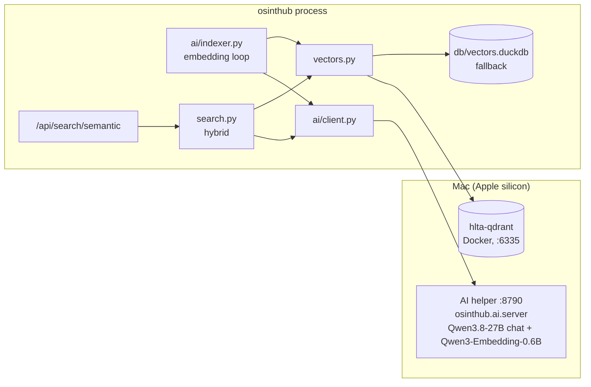

# Overview

Night Desk runs all of its AI locally, so analysis and search keep working with the internet cut. The models live in a separate helper process. The app talks to it over HTTP and never loads a model itself.



# AI helper

`osinthub/ai/server.py`, started with `uv run python -m osinthub.ai.server`. It binds to `127.0.0.1:8790` (`AI_HOST`, `AI_PORT`) and is OpenAI-compatible.

| Endpoint | Notes |
|---|---|
| `GET /health` | `ok`, and per model `id`, `loaded`, `error`; the embedding `dim` (1024). Answers while models load. |
| `GET /v1/models` | OpenAI model list. |
| `POST /v1/embeddings` | `input` (string or list, at most 2048). Extras: `kind` = `document` (default) or `query`, and an optional `instruction`. |
| `POST /v1/chat/completions` | `messages`, `max_tokens`, `temperature` (default 0), `top_p`. Extras: `response_format` and thinking control (below). No streaming. |

* **Models.** Chat is `mlx-community/Qwen3.8-27B-8bit` through mlx-lm (about 28 GB of unified memory). Embeddings are `Qwen/Qwen3-Embedding-0.6B`, loaded as a bare Qwen3 transformer in MLX. Both come from the Hugging Face cache with `HF_HUB_OFFLINE=1`, so the helper never downloads. Override with `AI_CHAT_MODEL` and `AI_EMBED_MODEL`, or set `AI_CHAT=0` to load only the embedder.
* **Embeddings.** Each text gets a trailing `<|endoftext|>`, and the vector is that last token's final hidden state, L2-normalised (last-token pooling, as the model card specifies). Queries are prefixed with `Instruct: Given a web search query, retrieve relevant passages that answer the query\nQuery:`; documents get no prefix. Inputs are sorted by length and run in batches of up to 32 (and about 16k tokens), truncated at 1024 tokens. 64 short documents take about 0.25 s.
* **Thinking.** Off by default. Turn it on with `"chat_template_kwargs": {"enable_thinking": true}` or `"enable_thinking": true`; the reasoning comes back in `message.reasoning_content`.
* **JSON output.** `response_format` `{"type": "json_object"}` or `{"type": "json_schema", "json_schema": {"schema": {...}}}`. mlx-lm has no constrained decoding, so the helper adds the schema to the system prompt and turns thinking off. It parses the reply (code fences removed) and checks it against a JSON Schema subset (type, required, properties, items, enum). If the reply fails, the model gets one repair turn. `content` is then compact JSON. The instruction, the parsing and the check live in `osinthub/ai/jsonout.py`, shared with the client's path to other chat servers ([chat connection](#chat-connection)), so every reply is checked the same way.
* **Concurrency.** One lock serialises generation and another serialises embedding batches, so a search embedding never waits behind a long extraction.
* **One instance only.** Two copies of the 27B model would exhaust a 64 GB Mac. Feature code uses the client and never loads models.
* **Who can reach it** (v1.2 pre-alpha, M2). The same guards as the app, from the shared `osinthub/httpguard.py` (the
  helper never imports the app or its configuration): a **Host allowlist** against DNS rebinding (`localhost`,
  `127.0.0.1`, `[::1]`, `host.docker.internal` for the app in Docker, the bind address when it is a specific one,
  and the names in `AI_ALLOWED_HOSTS`; anything else is **421**), and state-changing requests from another site or
  origin (`Sec-Fetch-Site`, `Origin`/`Referer`) are **403**, so a web page cannot use the model or hold its lock. A
  non-loopback `AI_HOST` without **`AI_TOKEN`** refuses to start with one line; with a token set, every request
  needs `Authorization: Bearer <token>` (**401** otherwise; compared as hashes in constant time). The app sends its
  own `AI_TOKEN` on every call (`ai/client.py`; Docker Compose passes it to the container). FastAPI's `/docs` and
  `/openapi.json` are off.

Run it in the background:

```sh
nohup uv run python -m osinthub.ai.server > logs/ai-server.log 2>&1 &
curl -s 127.0.0.1:8790/health
```

MLX is in the `mlx` dependency group with a `sys_platform == 'darwin'` marker, listed in `default-groups`. `uv run` installs it on a Mac, and `uv sync --frozen --no-dev` in the Linux image skips it.

# Turning AI on

The install brings no AI libraries and no models. Each person turns AI on in **Settings › AI**
(`web/js/views/settings/ai.js`, `osinthub/ai/setup.py`) and chooses what to download for their own Mac (owner,
2026-11-20); leaving the libraries out of the install is the lead's design, so the one switch controls all of AI.

* **Two parts.** *Search by meaning* is always the built-in helper's search model, because its vectors fill the
  search index (`FLOAT[1024]`, `config.EMBED_DIM`) and must all come from one model; it is never sent elsewhere (owner,
  2026-11-21). *Chat* can be the built-in helper or another server ([chat connection](#chat-connection)). The page has
  one card for each.
* **Who can** (the built-in helper). A native run on Apple silicon, with `AI_URL` on this computer. In Docker the
  helper runs on the Mac outside the container, so the page explains that instead; on another computer or a Mac
  without Apple silicon it says why. Chat on another server works everywhere, Docker included.
* **The choice.** The search model (`AI_EMBED_MODEL`, about 1.2 GB, about 2 GB of memory), and for built-in chat one
  MLX model: the recommended `AI_CHAT_MODEL` (about 28 GB, needs at least 48 GB of memory) or any MLX language model
  already in the Hugging Face cache (`setup.mlx_chat_models()`: a complete snapshot whose `config.json` names a
  `…CausalLM` or `…ConditionalGeneration` architecture and has MLX `quantization` or "mlx" in the repo name, with
  `.safetensors` weights; the search model is left out). A cached model needs its size × 1.2 plus 12 GiB of memory.
  The choice is `chat_repo` in `ai.json`. Built-in chat always comes with the search model (the helper always loads
  it). Models already in the Hugging Face cache are not downloaded again.
  `POST /api/ai/setup/plan` checks the choice: memory, offline mode (nothing is downloaded offline, but models
  already on disk can be turned on), `uv` for the libraries, and free disk space (the download plus 10 %).
* **The download** (`POST /api/ai/setup`, one background job, `DELETE /api/ai/setup/job` stops it): the AI libraries
  (`mlx-lm`, pinned to its `uv.lock` version) go into `<config>/ai/libs` with `uv pip install --target`, unless the
  app's own environment has them (a source checkout does). Each chosen model is downloaded by
  `python -m osinthub.ai.fetch <repo>` in its own process into the Hugging Face cache (`HF_HUB_CACHE`, `HF_HOME` or
  `~/.cache/huggingface/hub`), reporting bytes as it goes; an interrupted download resumes next time.
* **The helper.** When the download finishes the choice is saved in `<config>/ai/ai.json` (per machine, never in the
  data folder) and the app starts `python -m osinthub.ai.server` on `AI_URL`'s port, on loopback, with `AI_CHAT=0`
  unless the chat model was chosen, `HF_HUB_OFFLINE=1`, and the libraries on its path after the app's own packages
  (`OSINTHUB_AI_LIBS`). Its log is `<config>/ai/helper.log`. The app starts it again at every start while AI is on, and
  stops it as the app shuts down (the `ai` extension's `on_stop`), except for a restart in place, whose new start
  reuses it. A helper that already answers on `AI_URL` (for example one started by hand) is used as it is and never
  stopped by the app. Once on, the helper counts as expected (`helper.configured`), so a stopped one shows as a problem.
* **Turning off** (`POST /api/ai/setup/off`) stops the helper and forgets the choice; built-in chat goes off with it,
  chat on another server stays. Deleting the models and the libraries are separate ticks. Only models Night Desk
  downloaded itself are deleted (`downloaded` in `ai.json`, written by every turn-on, so a model that was already in
  the cache, another app's or one picked from it, is never deleted; a choice saved before the list existed counts the
  recommended models). Models are deleted with huggingface_hub's own cache deletion
  (`python -m osinthub.ai.fetch --delete <repo>`), which also clears their files in the cache's shared store unless
  another model uses them.

Tested end to end on 2026-11-21 with the installed package (no AI libraries in it): libraries and search model
downloaded from the page, the helper started by the app, 3,776 CVEs and 330 events embedded and search answered in
hybrid mode, the helper stopped with the app and started again with it, and turning off freed the 1.1 GB and the
387 MB of libraries.

# Chat connection

`osinthub/ai/chatconn.py`, **Settings › AI › Chat** (owner, 2026-11-21: the OpenAI chat format, the most widely
supported; tested with MLX and Ollama). Chat (entity briefs, story summaries, entity extraction from articles) goes
to one of:

| `via` | Where | Found by |
|---|---|---|
| `builtin` | the AI helper (`AI_URL`), with the chat model chosen above | the MLX models in the Hugging Face cache |
| `ollama` | Ollama, default `http://127.0.0.1:11434/v1` | `GET /api/tags` (models without the `completion` capability, embedding models, are left out) |
| `lmstudio` | LM Studio, default `http://127.0.0.1:1234/v1` | `GET /v1/models` (ids with "embed" left out) |
| `other` | any OpenAI-compatible base URL: another machine, or a provider (OpenRouter, OpenAI, Anthropic's or Gemini's compatibility endpoints) | `GET <url>/models`, or a typed model name |

In Docker the Ollama and LM Studio defaults use `host.docker.internal`. `POST /api/ai/chat/discover` asks both
default ports (one second each, side by side) and lists the MLX models; nothing is contacted before the page asks.

* **Saved** as `{"chat": {"via", "url", "model"}}` in `<config>/ai/ai.json`; no saved `via` means built-in when the
  built-in chat model is on, else off. The URL is normalised (`localhost:11434` → `http://localhost:11434/v1`; an
  address off the local network gets `https://`; a trailing `/chat/completions` is dropped; user:password, `?` and `#`
  are refused).
* **API key** in `<config>/ai/chat-key.json`, mode 0600, as `{host, key}`: it is sent only to that host and port, so
  saving another address without a new key drops it. It is never returned (`has_key` only), and diagnostics remove it
  wherever it appears. Saving without a key keeps the saved one for the same host; turning chat off deletes it.
* **Local or not.** Loopback, RFC 1918, CGNAT, link-local and `fc00::/7` addresses, `localhost`,
  `host.docker.internal` and names ending `.local`, `.lan`, `.home.arpa`, `.internal`, `.localdomain` or `.localhost`
  count as local; any other name counts as local only if every address it resolves to is. A server that is not local
  gets a notice on the page (article text and brief facts are sent to it), the app's proxy settings, and a 5 s connect
  timeout; **offline mode** refuses to save one and pauses one already saved (`blocked_offline`).
* **Moving chat off the built-in helper** (`save` or `turn_off`) drops `chat` from the chosen models and restarts the
  helper with search only, in the background, so its chat model's memory is freed.

## Requests to another server

`client.chat()` keeps its signature; with an external connection it sends a plain OpenAI request (`model`,
`messages`, `max_tokens`, `temperature`, `stream: false`). Ollama also gets `reasoning_effort: "none"` when thinking is
off (Ollama 0.40 turns thinking off with it; with no field a Qwen3 model thinks for ~100 tokens first); other servers
get no extra field, since a strict server rejects fields it does not know.

* **JSON** (`json_schema` given): the schema instruction goes into the system prompt (`jsonout.with_hint`), and the
  request asks for `response_format` `json_schema`, then `json_object`, then nothing, moving down when a server
  answers 400 (remembered per connection). The reply is parsed and checked here (`jsonout.problem`) with one repair
  turn, as the helper does; still invalid, the call returns `None`.
* A leading `<think>…</think>` is removed from replies.
* **Down state** is per connection: a connection error marks the server down for 30 s, 429 or 503 for 30 s, and 401
  or 403 (a refused key) for 5 minutes; a read timeout does not (busy, not gone). `client.is_down()` is chat's state
  (its callers only gate chat work); `client.helper_down()` is the helper's (embeddings).
* `client.status()["chat"]` (and `helper_chat` in `GET /api/ai/setup`) reports `{via, model, url, is_local, down,
  ever_up, last_error}`; diagnostics say which kind of server and whether it is local, never the key.

Tested on 2026-11-21 against a scratch app: Ollama 0.40.16 (`qwen3:0.6b`) found, tested and used for an entity
brief; the built-in helper with an MLX model already in the cache (`mlx-community/Qwen3-0.6B-4bit`, nothing
downloaded) wrote a brief while search ran in hybrid mode; moving chat to Ollama restarted the helper with search
only; the helper stopped with the app and started again with it.

# AI client

`osinthub/ai/client.py`:

* `embed(texts, kind="document" | "query") -> list[list[float]] | None`
* `chat(messages, json_schema=None, max_tokens=1024, temperature=0, think=False) -> str | None`

Both return `None` instead of raising when the helper can't answer. The connect timeout is 0.5 s. The read timeout is 2.5 s for query embeddings, 60 s for document batches, and 300 s for chat. Any connection error, or an embedding read timeout as from a hung helper, marks the helper down for 30 s. A chat that times out behind other generations does not mark it down (5 s after a 503 while it loads). Until then, calls return `None` at once, so a hung helper costs one search 2.5 s and the rest none. The client ignores `HTTP(S)_PROXY` (`trust_env=False`), because the helper is local. `AI_URL` defaults to `http://127.0.0.1:8790`; Docker sets `http://host.docker.internal:8790`.

The helper is optional. `GET /api/ai/status` reports `helper.configured` (true only when `AI_HELPER=1|on|required` says it is expected; `AI_URL` alone does not count, as Docker always sets it) and `helper.ever_up` (it answered at least once during this server run). The Sources card shows a red "Not responding" only when one of them is true; otherwise a grey "Not running — optional" with how to start it, and the raw connection error only under Details.

# Vectors

`osinthub/vectors.py`: `upsert(collection, items)`, `search(collection, vector, k, filter=None)`, `count(collection)`, plus `delete` and `drop`. Items are `{id, vector, payload}`. `upsert` raises `ValueError` for a missing id, a wrong dimension, NaN or infinity, or an all-zero vector. `search` raises `ValueError` for a malformed query vector. It returns `[]` only when the backend itself is unavailable, which it logs. `OSINTHUB_QDRANT_PREFIX` prefixes Qdrant collection names, so several lakes can share one Qdrant. A filter is `{payload_field: value or [values]}`. The collections are `cves`, `articles` (chunks), `entities` and `events`.

| `OSINTHUB_VECTORS` | Backend |
|---|---|
| `auto` (default) | Qdrant if it answers within 1 s, else DuckDB. Rechecked every 30 s. |
| `qdrant` | Qdrant REST at `QDRANT_URL`, with `QDRANT_API_KEY` if set. Point ids are UUIDv5 of `collection:id`; the original id is in the payload. Cosine distance, 1024 dimensions. |
| `duckdb` | `db/vectors.duckdb` (`OSINTHUB_VECTORS_DB`), table `vectors(collection, id, vector FLOAT[1024], payload JSON)`. Brute-force `array_cosine_similarity`, which is built in, so no extension is downloaded. About 3 ms over 3.5k vectors. The connection reads no file besides its own database and never the network (`db.restrict`). |

The index is **derived**. Everything in it is rebuilt from the warehouse and lake, so deleting the Qdrant storage or `vectors.duckdb` costs only a re-embed. What each backend holds is tracked in `vector_index(backend, collection, id, hash)` in `vectors.duckdb`. If a backend's collection turns up empty while the tracking table says it should be full, the indexer starts over.

HLTA's Qdrant is the Docker container `hlta-qdrant`, image `qdrant/qdrant:v1.20.0`, published on `127.0.0.1:6335` with no API key, and its storage in a host folder (on the owner's setup, a folder on the external data drive named in the private machine page outside the repo). Ports 6333 and 6334 are taken by another Qdrant on the host, which Night Desk must not use.

```sh
docker run -d --name hlta-qdrant --restart unless-stopped -p 127.0.0.1:6335:6333 \
  -v /Volumes/ExternalDrive/hlta-qdrant:/qdrant/storage qdrant/qdrant:v1.20.0
```

# Embedding pipeline

`osinthub/ai/indexer.py`, registered as the `ai` extension, runs a pass every 60 s:

1. It builds the documents (`osinthub/ai/docs.py`):
   * **CVE documents**, one per CVE id, merge NVD and KEV events with the provider records in the lake. Events keep only 600 characters of description, so the full text comes from the records. Each document holds the CVE id and name, the affected vendors and products (from KEV, the CVE `affected` list and CPEs), the full description, the KEV description, CWE ids with their names, CVSS, and the KEV and ransomware flags.
   * **Event documents** are the title and summary of news and social events.
2. It hashes each document and embeds only those whose hash differs from what the active backend holds, 128 per call. Vectors for documents that are gone, for example removed by [retention](/data/architecture.md#retention), are deleted from the backend and from the tracking table.
3. If the helper is down, the pass stops and the next one catches up. Changing the document format (`DOC_VERSION`) re-embeds everything.

The first full pass embeds about 3,450 CVEs in 24 s. `GET /api/ai/status` shows helper health, the backend and counts, and pending documents. `POST /api/ai/reindex` runs a pass now. Other packages add their own collections with `indexer.register_corpus(collection, fn)`.

# Search

`osinthub/search.py`: `semantic(q, types=None, k=10) -> [{type, id, title, score, snippet, url, ...}]`, served as `GET /api/search/semantic?q=&types=cve,event&k=10`.

* **Keyword retrieval** (`osinthub/keyword.py`) is a field-weighted BM25 (BM25F). The weights are id ×4, CVE name ×2.5, vendor and product ×2.5, title ×2 and body ×1. Its analyser:
  * removes stop words and applies a light suffix stemmer (inject, injection and injected all match);
  * adds **concept tokens** for about 45 vulnerability classes, so "RCE", "remote code execution" and "run arbitrary code" all give `~rce`, and "unauthenticated" and "without logging in" give `~unauth`;
  * adds **vendor tokens** for well-known products (Exchange → Microsoft, FortiGate → Fortinet, D-Link = DLink).
  
  Documents and queries are analysed the same way. Possessives are stripped (Google's → google) and camelCase names are also split (BackgroundFetch → background fetch).
* **Comparable scores.** A keyword score is BM25F divided by the score of an ideal document that holds every query term once, squashed to 0..1 as `x / (x + 0.5)`. It is not normalised to the best hit, so a weak one-word match in one type ranks below a full match in another.
* **Hybrid.** For each type, up to 60 vector hits and 60 keyword hits are fused: `score = cosine + 0.5 × keyword`. Keyword-only candidates (not embedded yet) get the weakest cosine among the vector hits. A CVE id in the query puts that CVE first.
* **Keyword fallback.** Without a query embedding (helper down), results come from BM25 alone. The `mode` field says `hybrid` or `keyword`.
* **Searcher registry.** `register_searcher(type, fn)`, where `fn(q, qvec, k)` returns results with a `score` of about 0 to 1 and must work when `qvec` is `None`. `hybrid()` and `keyword_index()` are there for reuse. Foundation registers `cve` (id = CVE id) and `event` (id = event id). News and entities add `article` and `entity` from their ext modules.

Measured with `tests/eval/score_cve_search.py` (45 paraphrased questions) on the 2026-11-04 seed:

| Mode | Own set (45) | Critic set (20) |
|---|---|---|
| Hybrid, DuckDB vectors | 0.911 / 0.822 | 0.900 / 0.750 |
| Hybrid, Qdrant vectors | pending (Docker could not start containers) | |
| Keyword only (helper down) | 0.889 / 0.822 | 0.750 / 0.700 |

Each cell is recall@5 / top1. The fusion weight and analyser were tuned only on 60 synthetic questions the local LLM wrote from random CVE records, never on the gold sets. On those 60 questions: keyword 0.917 / 0.650, hybrid 0.933 / 0.683. Most remaining misses are near-duplicates, such as dozens of Chrome CVEs from the same release.

# Offline mode

`OSINTHUB_OFFLINE=1` (`config.OFFLINE`) stops all outbound fetching:

* The scheduler marks every source `offline` and starts no batch or stream loops.
* `run_batch` returns `{"ok": false, "skipped": true}`.
* Stream sources return at once.
* The feed fetch helper raises before any request.
* Bootstrap skips missing reference downloads.
* The scheduler's HTTP client gets a transport that refuses every request, as a backstop.

Feature packages that fetch (for example article fetching) must check `config.OFFLINE` themselves and skip without raising. Local services still work: the AI helper and Qdrant are reached without any proxy. Startup takes under a second, and the app serves what the lake and warehouse already hold.

# Data kept away from AI

Some providers' terms forbid using their data with AI models. abuse.ch's Terms of Use (s7.3, 2026-10-21) say the data may not be used to "customise, train, or otherwise improve" AI models, so ThreatFox, URLhaus and SSL Blacklist are marked `ai_ok = False` (`GET /api/sources`), and:

* the entity brief (`osinthub/news/brief.py`) drops their claims, evidence and mention counts before building facts, so they never reach the LLM prompt; a claim merged with an abuse.ch one (Feodo + ThreatFox on one triple) keeps only the other source's evidence, loses its stored confidence (which includes the abuse.ch corroboration) and takes its dates from the remaining evidence; an entity known only from them (`attrs.ai_excluded`) gets no LLM wording at all;
* malware families created only from them (`attrs.ai_excluded`) are never embedded into the `entities` vector collection;
* event vectors cover news and social kinds only, and entity extraction runs on article text only, so their events never reach either.
