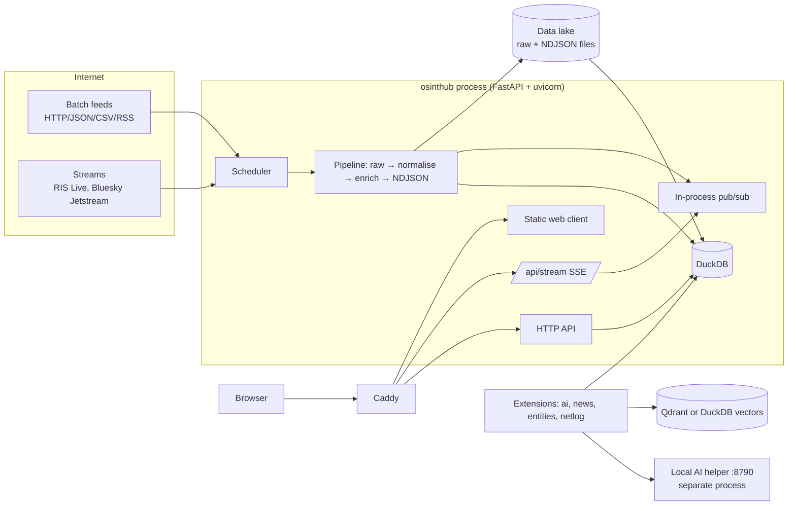

# Overview

Night Desk is one Python process that does three jobs: it runs the ingest scheduler, serves the HTTP API and live event stream, and serves the static web client. DuckDB is embedded in that process. In Docker, Caddy sits in front and serves the app over HTTPS at the site root ([deployment](/architecture/deployment.md)).

# Backend modules

| Module | Role |
|---|---|
| `osinthub/__main__.py` | Entry point; starts uvicorn with host/port from config. |
| `osinthub/config.py` | Paths and settings from `OSINTHUB_*` environment variables (including the `OSINTHUB_ALLOWED_HOSTS` Host allowlist); creates lake folders, but refuses to start when the lake or DB is on an unmounted `/Volumes/<name>` drive. |
| `osinthub/bootstrap.py` | On startup, downloads missing reference data (GeoIP, ASN, cables, countries). |
| `osinthub/api.py` | FastAPI app: lifespan (connect DB, bootstrap, start scheduler), the request guard (Host allowlist against DNS rebinding, CSRF check on writes, security headers; [deployment](/architecture/deployment.md#host-allowlist-dns-rebinding)), all [endpoints](/architecture/api.md), static mount. |
| `osinthub/scheduler.py` | Starts one asyncio task per enabled source (batch loop or stream loop), computes record deltas, records state and runs, checkpoints DuckDB every 10 minutes, and runs housekeeping (closing stream hours, optional retention). |
| `osinthub/lake.py` | Lake files: record-delta writer, hourly stream files, and the user retention setting and purge. |
| `osinthub/sources/` | Source plugins (`feeds.py` batch, `streams.py` live, `upload.py` user files), the `Source` contract and `Event` model (`base.py`), and the registry. |
| `osinthub/geo.py` | IP to location and ASN lookups (DB-IP Lite), country centroids, and country-name tagging of free text. |
| `osinthub/db.py` | DuckDB connection, schema and migrations, per-thread cursors, a write lock, batch upsert with event deltas, record hashes, settings and metric writes. |
| `osinthub/analytics.py` | The [Cyber Pulse](/data/cyber-pulse.md) index. |
| `osinthub/bus.py` | Thread-safe pub/sub that fans messages out to SSE subscribers. |
| `osinthub/ext.py` | [Extension registry](#extensions): feature packages add schema, routers, background tasks and startup hooks. |
| `osinthub/vectors.py` | Vector index with Qdrant and DuckDB backends ([local AI](/architecture/local-ai.md#vectors)). |
| `osinthub/search.py` | Hybrid vector and keyword search with a searcher registry, served at `/api/search/semantic` ([local AI](/architecture/local-ai.md#search)). |
| `osinthub/ai/` | Client for the local AI helper, the helper itself (a separate process), CVE and event search documents, and the embedding pipeline ([local AI](/architecture/local-ai.md)). |

# Extensions

Features such as `ai`, `news`, `entities` and `netlog` are packages under `osinthub/`, each with an `ext.py` that calls `ext.register(name, schema_sql=None, router=None, tasks=(), on_start=None, on_stop=None)` at import time. `ext.load_all()` finds every `osinthub/*/ext.py` and imports it inside `try`/`except`.

| Piece | When it runs |
|---|---|
| `schema_sql` | Run on the DuckDB connection in `db.connect()`, after the core schema and migrations. Use `IF NOT EXISTS`. |
| `router` | A FastAPI `APIRouter` with its own `/api/<name>` prefix, included in `api.py` before the static mount. |
| `on_start` | A sync or async hook run once in the lifespan, after the scheduler starts. |
| `on_stop` | A sync or async hook run once as the app shuts down, after the tasks are cancelled (the `ai` package stops the helper it started). A failing hook is logged. |
| `tasks` | Async functions with no arguments, started after the hooks. A task that raises is logged and restarted with backoff (5 s doubling to 10 min). |

Each step is isolated. If a module raises during import, everything it registered is rolled back, so no part of a half-imported extension is used. Sync `on_start` hooks run in a worker thread so they can't stall the event loop. A package that fails to import, or whose schema, router, hook or task fails, is logged, and the app runs without it. `GET /api/extensions` lists what loaded, what failed to import, and recent errors.

# Source plugin contract

A source subclasses `Source` and is registered with `@register`. Class attributes describe it (`id`, `name`, `provider`, `homepage`, `description`, `category`, `mode`, `interval`, `default_enabled`, `license`, `raw_ext`, `windowed`); these drive the Sources page and how the lake stores changes.

* **Batch** sources implement `fetch(client) -> bytes` and `parse(raw) -> list[Event]`, and optionally `records(raw) -> list[(key, record)]` to split the payload into keyed provider records so only changed ones are stored. Without it, the whole payload is one record and is stored only when it changes. Set `windowed = False` for lists, where a missing key means the provider removed it.
* **Stream** sources implement `stream(sink)`; they call `sink.emit(event)` for stored events, `sink.metric(name, value)` for time series, `bus.publish(topic, data)` for UI-only pulses, and `await sink.flush()` periodically.

An `Event` carries a stable key (deduplication), timestamp, title, optional summary, severity 0-1, coordinates, country, IP, ASN, URL, tags and a numeric value. See [data architecture](/data/architecture.md) for what happens next.

# Request and update flows

* **Page load:** the browser loads `index.html` and ES modules, then calls the JSON API for each panel.
* **Live updates:** the browser holds one `EventSource` on `/api/stream`. After each batch or stream flush the server publishes `events`, `source`, `metric`, `bgp_pulse` and `social` messages; panels subscribe to the topics they need ([web client](/architecture/web-client.md)).
* **Writes:** all DuckDB writes go through one lock; reads use per-thread cursors so API requests run in parallel with ingest.

# Startup

1. Open DuckDB and create tables if missing.
2. Download any missing reference data.
3. Start every enabled source. Batch sources that ran recently wait out the rest of their interval; others run at once.
4. Start the checkpoint and housekeeping loops.
5. Run extension `on_start` hooks and start extension tasks, such as the [embedding pipeline](/architecture/local-ai.md#embedding-pipeline).

With `OSINTHUB_OFFLINE=1`, steps 2 and 3 fetch nothing: sources are marked `offline`, and startup takes under a second ([offline mode](/architecture/local-ai.md#offline-mode)).

# Constraints

* DuckDB allows one writer process per file. Stop the old process fully before starting a new one, or startup fails with a lock error.
* The python.org macOS build has no system root certificates; websocket clients use `certifi` explicitly.
* The app never disguises its User-Agent. Providers that refuse automated clients stay off.
* Models run only in the one [AI helper](/architecture/local-ai.md#ai-helper) process. Two copies of the 27B chat model would not fit in memory.

# Tests

The three test tiers (unit/API, E2E and the merge gate), their commands and times, and how the conftest
isolates each module in its own parallel child process are in [start here](/start-here.md#how-to-test). The
end-to-end journeys and the merge gate have their own page: [testing](/architecture/testing.md).
