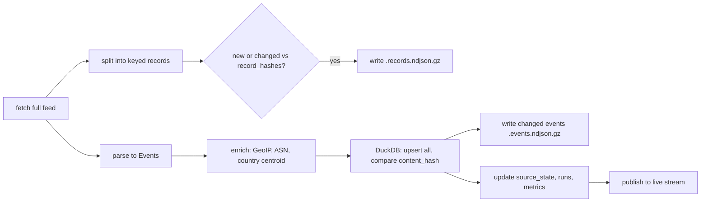

# Principles

* **The lake is the source of truth.** Every version of every record a source has returned is kept on disk, gzipped, together with the normalised events. DuckDB can be rebuilt from the lake.
* **Fetch everything, store what changed.** Batch sources always fetch their full feed or window, because providers backfill and revise data late. Only new, changed or removed records are written ([what the lake stores](#what-the-lake-stores)).
* **One event model.** Every source maps onto the same [events table](/data/events.md), so maps, charts and search work across sources.
* **Stable identity.** An event's id is `source:sha1(key)[:16]`, where the key is what makes the observation unique (an IP, a CVE id, a prefix plus origin change plus hour). Re-sightings update the row instead of adding one.

# Lake layout

The lake root is `OSINTHUB_LAKE` (default the app-data folder (`~/Library/Application Support/Night Desk` on macOS, `~/.local/share/nightdesk` on Linux), `/data` in Docker; for example `/Volumes/ExternalDrive/night-desk` to keep it on an external drive).

```
raw/<source>/YYYY/MM/DD/HHMMSS.records.ndjson.gz      new, changed and removed provider records from one run
raw/<source>/YYYY/MM/DD/HHMMSS.events.ndjson.gz       new or changed normalised events from that run
raw/<stream>/YYYY/MM/DD/HH.events.ndjson.gz           one file per hour of stream events, last row per id
raw/<source>/YYYY/MM/DD/HHMMSS.<ext>.gz               a full payload: older lakes, or a fetch that failed to parse
uploads/YYYY/MM/DD/HHMMSS-<file>                      user uploads, plus .events.ndjson.gz
tmp/streams/<stream>/YYYYMMDDHH.ndjson                the open stream hour; gzipped into raw/ when it closes
tmp/                                                  scratch files used while loading (removed after each load)
ref/dbip-city-lite.mmdb, dbip-asn-lite.mmdb           IP location and ASN (DB-IP Lite, CC BY 4.0)
ref/cable-geo.json, landing-point-geo.json            undersea cables and landings (TeleGeography; opt-in, on first use)
ref/countries-110m.geojson                            country shapes and label points (Natural Earth)
db/hub.duckdb                                         the warehouse
```

All times in paths are UTC. A records line is `{"key", "op": "put", "data": <provider record>}` or `{"key", "op": "del"}`.

# Pipeline



1. **Fetch.** One run of a source at a time: a run (scheduled or Run now) while another is in progress is refused (`POST /api/sources/{id}/run` answers 409 `already running`; the scheduler waits for it). Stopping a source cancels its run; thread work already started finishes, but none of its state writes land after "disabled" (a per-source generation), and the run counts as in progress until that work is done. Batch sources fetch their whole feed on their interval with the app's honest User-Agent; streams hold a websocket open. An RSS feed that returns an HTTP error or a body that is not RSS/Atom fails the run (single-feed sources). In a multi-feed source the other feeds still load, and the dead feed's error is kept on the run and the source's status.
   * A fetch may raise `Unchanged` (sources/base.py) when the provider says nothing is new (a daily file already loaded, a 304): the run is recorded as ok with nothing loaded and no download. EPSS uses it.
   * Optional source hooks: `prepare(raw, collected_at)` runs before `parse()` for idempotent side-table writes the linker needs (CISA advisories' `advisory_cves`); `commit(raw, collected_at)` runs last, only after the lake delta, record hashes and event load succeeded, for state that gates the next fetch (EPSS replaces its `epss` table there, so a failed run is retried for real); `stored_count()` gives the source total when it is not an event count (EPSS: rows in `epss`). The side tables are rebuildable from the lake records.
2. **Parse.** The source's `parse()` maps records to Events, skipping junk (rejected CVEs, comment lines, non-English posts). If parsing fails, the full payload is saved for debugging. Timestamps are parsed by `to_ts` (ISO 8601, RFC 822 in any zone including `GMT`, epoch seconds, milliseconds or microseconds). A missing or unparseable time becomes the collection time, which the event delta treats as app-stamped; unparseable shapes are logged once. Display text that providers send HTML-entity-encoded (`&amp;`, `&#39;`, `&quot;`) is decoded to plain text by one shared decoder (`osinthub/sources/text.py`: well-formed entities only, decoded until nothing is left to decode, so its output is never decoded again) in the news feeds, `nvd_recent`, `bluesky_cyber` and `ransomware_live`; keys, URLs, hashes, indicators and the stored provider records keep exactly what was sent. Events stored before a source decoded its text are fixed in DuckDB by that source's next run (`prepare()`, or the stream's connect) and given the content hash `parse()` gives them today, so they are not stored again as changed and the entity linker extracts their mentions again, once; the lake files are not rewritten. Clients escape the text where they show it. Which sources decode (audit of every source in `osinthub/sources/`, 2026-11-18):

   | Source | Decoded | Why |
   |---|---|---|
   | RSS news feeds (`security_news`, `news_*`) | yes | Feed titles and summaries carry entities, some double-encoded |
   | `nvd_recent` | yes | CNA-submitted descriptions carry `&#39;`, `&quot;`, `&amp;` |
   | `bluesky_cyber` | yes | Posts copied from web pages or made by feed bots carry entities as typed |
   | `ransomware_live` | yes (title, summary) | Victim names and descriptions are scraped from leak-site HTML; keys, tags and URLs stay as sent |
   | `cisa_kev` | no | Structured JSON catalogue in plain text |
   | `cisa_advisories` | no | CSAF JSON in plain text; `&` appears only in URL queries |
   | `threatfox`, `urlhaus`, `sslbl` | no | Indicators, URLs and reasons such as `C&C`: decoding would change them |
   | `feodo_c2`, `dshield_top`, `tor_exits`, `blocklist_de`, `cins_army`, `et_compromised`, `spamhaus_drop` | no | Addresses, networks, numbers and identifiers only |
   | `ioda_outages`, `epss` | no | Place names and numbers from structured JSON or CSV |
   | `ris_live`, `rpki_roas`, `ripestat`, `cf_radar_bgp` | no | No events made from provider text (routing findings use prefixes and AS numbers) |
   | `upload` (files added by hand) | no | The user's own file, stored as given |
3. **Record delta.** The source's `records()` splits the payload into keyed provider records (one CVE, outage, IP, netblock or article each). Each is hashed and compared with `record_hashes`. New or changed records, and for lists the keys that disappeared, are written to `HHMMSS.records.ndjson.gz`. A run with no changes writes nothing. When part of a payload failed to fetch (a dead feed of a multi-feed source, a CSAF document that did not download), the keys that may belong to the failed part (`Source.unseen`: for RSS, keys of the dead feed; by default every key) keep their stored hashes and are never counted as removed, so the part's unchanged records are not written again when it recovers; keys of the parts that did load age out or are removed as usual, so the stored set does not grow while a part stays down.
4. **Enrich.**
   * Events with an IP get latitude, longitude, country and city from DB-IP City Lite, and an ASN plus an `org:<owner>` tag from DB-IP ASN Lite.
   * Events with only a country get the country's label point.
   * News and social text is tagged with the countries it mentions.
5. **Load and event delta.** The whole batch goes through a scratch file into a DuckDB temp table. Every row is upserted, so timestamps and `ingested_at` stay current. Rows whose `content_hash` differs from the stored row are also copied to `HHMMSS.events.ndjson.gz` with DuckDB's gzip `COPY`.
6. **Bookkeeping.** The run is recorded in `runs` with how many records and events changed. The source's status and counts are updated in `source_state`, and per-run counts go to `metrics` ([operational tables](/data/operational-tables.md)).
7. **Publish.** When anything changed, the newest events are pushed to browsers over `/api/stream`.

Streams buffer events and flush every 5-10 seconds. Each flush is loaded into DuckDB at once and appended to the open hour's file in `tmp/streams/`. A housekeeping task checks every minute and gzips closed hours into `raw/`, keeping the last row per event id. BGP announcement "pulses" for the map are published live but never stored.

# Derived events

Some events are computed rather than copied:

* **BGP origin change:** a prefix announced by a different origin AS than last seen, at most once per prefix per hour.
* **BGP withdrawal burst:** 40 or more prefixes from one origin AS withdrawn within 60 seconds, at most once per AS per 15 minutes.
* **Social posts** are kept only if they contain a CVE id or at least two distinct cyber terms.

# DuckDB

One connection per process, a cursor per thread, and a lock around writes. The schema is created at startup. A checkpoint every 10 minutes folds the write-ahead log into the database file. Before checkpointing was added, the log reached 70 MB against a 14 MB database. The Explorer's SQL console runs read-only queries against the same tables.

# What the lake stores

Most batch sources return a whole list or a sliding window each run: IP lists, the KEV catalogue, NVD's last 72 hours, IODA's last 7 days. Consecutive fetches overlap almost entirely.

* **Full fetch, every run.** The app never asks only for "new since last time". Providers publish late and revise records (NVD adds CVSS scores later, IODA extends ongoing outages), and a full window catches both.
* **Records.** A record is stored when its key is new or its content hash changed. A key the provider lists more than once is stored as one record holding all copies. *Lists* (`windowed = False`: IP lists, KEV, Feodo, DShield, Spamhaus DROP) also store a `del` line when a key disappears, so the full list at any past time can be rebuilt by replaying the files. *Windows* (NVD, IODA, news, ransomware) don't record ageing out of the window as a removal. A list that suddenly comes back empty is treated as a failed run rather than a mass removal.
* **Events.** `content_hash` covers every field except timestamps the app stamped itself (at or after collection time), so an IP that stays on a list is not re-stored just because it was seen again.
* **Delisted entries stay in `events`.** DuckDB `events` is a sightings table, not a mirror of the current list: a list entry the provider removes is recorded as a `del` in the lake and dropped from `record_hashes`, but its event row stays, with `ingested_at` frozen at the last run that listed it. So event counts for list sources (`items_total`, map and Explorer views) include past members. The current list is `record_hashes` for the source, or the source's events with its latest `ingested_at` (every row of one run is upserted with the same time); plain IP lists load at most 6,000 IPs per run as events, so a longer list such as blocklist.de is complete only in `record_hashes`). Rows leave `events` only through DB retention.
* **Author deletes are recorded, not applied.** `deletion_requests` (event id, source, url, `requested_at`, `recorded_at`) marks stored events whose author deleted them at the source: today Bluesky posts, from Jetstream delete events (`BlueskyCyber.deletion`, `db.record_deletion_requests`; only ids already in `events` are kept). The event stays in `events` and the lake and shows as before; NOTICE leaves what to do with it to the user. Deletes made while the stream is down are not seen.
* **Compression.** gzip level 6 everywhere. DuckDB's `read_json` reads `.ndjson.gz` directly.
* **Severity on fixed scales.** Severities don't depend on the rest of the batch: IODA uses a log scale where score 100 maps to 0.25 and 1,000,000 to 1.0. Otherwise one new large outage would rescale, and so re-store, every other row.
Measured over the first 12 hours, excluding each source's first full load:

* Window feeds store 5-11% of a gzipped full snapshot (NVD 5%, news 5%, IODA 11%).
* Lists store under 1%.
* DShield, whose top-500 changes almost entirely every hour, stores about 90%.
* Hourly stream files are about 3× smaller than per-flush files.

See [storage estimates](/data/storage-estimates.md).

# Retention

Off by default: nothing is ever deleted unless the user sets a limit in the Sources view (or with `PUT /api/settings/retention`). Each limit is a number of days, or empty to keep forever.

* **Lake files.** Deletes `raw/` day folders older than the limit, hourly. Records and events last stored before the cutoff then have their hashes cleared, so the next run stores them again. The kept window always contains a complete copy of everything still active. Uploads are never deleted.
* **DuckDB events.** Deletes events not seen again within the limit (by `ingested_at`), plus `runs` and `metrics` older than that, then checkpoints.

Saving a limit applies it immediately; clearing both turns retention off.
