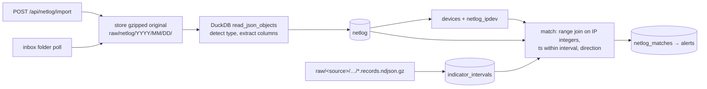

# Overview

The `osinthub/netlog/` package imports Zeek logs the user exports from their own sensor. It never scans or captures traffic. It matches each log row against the threat lists the hub already collects, *as they were at the time of that row*. Everything works offline: import, devices, matching, re-hunting and alerts need only DuckDB and the lake.



# Import

* **Formats.** Pi-hole and AdGuard Home DNS logs are recognised first (see [DNS sinkhole logs](#dns-sinkhole-logs)). Zeek JSON as NDJSON (one object per line, `LogAscii::use_json=T`) or as one JSON array, plain or gzipped (detected by the gzip magic bytes, not the file name; multi-member gzip works).
  * Zeek TSV is rejected with a message saying to enable JSON output. An empty file is an error.
  * A file in which no row has recognised Zeek or EVE fields is rejected ("not a Zeek or Suricata EVE log").
* **Suricata EVE.** Records with `event_type` and `src_ip`/`dest_ip` are mapped to the same columns, with log types `eve_<event_type>`:
  * `flow.start` (else `timestamp`) → `ts`, so a long flow is dated when it began; `flow_id` → `uid`; `app_proto` → `service`.
  * Orientation is the flow's, not the packet's. `flow.src_ip`/`dest_ip` (and ports) are used when present; otherwise, for `direction: to_client`, the packet's src and dest are swapped. An alert on a C2's response packet is therefore home → C2.
  * `flow.bytes_toserver`/`bytes_toclient`/`age`/`state` → bytes, duration and state.
  * `dns.rrname` and `dns.answers[].rdata` (or `rdata`) → query and answers. `tls.sni`, `http.hostname`/`url` and `ether` MACs are also mapped.
  * The import result carries a warning saying how many EVE records were mapped. `eve_flow` counts as a connection; `eve_dns` lookups are matched like Zeek DNS.
* **Bundles.** A tar, tar.gz or zip upload (or inbox file) is unpacked, and each regular member is imported as its own file, named `<bundle>/<member>`; gzipped members work. The result has `bundle`, `members` (one result each) and summed `rows`, `inserted` and `log_types`.
* **Normalisation at import.**
  * Addresses become canonical: IPv4-mapped `::ffff:a.b.c.d` becomes `a.b.c.d`, and IPv6 is written in RFC 5952 form (lower case, compressed). This applies to `orig_h`, `resp_h` and DNS answers, and to indicator values.
  * Names (`query`, `server_name`, `host`, answers) are lower-cased and lose a trailing dot. HTTP `host` loses `:port` and the brackets around an IPv6 literal.
* **Timestamps.** `ts` (or EVE `timestamp`) may be epoch seconds, milliseconds, microseconds or nanoseconds (by magnitude), as a number or a string, or ISO 8601 with any offset (UTC if none). A value outside 1990-2100 or that cannot be parsed is stored as NULL, counted in `bad_ts` and reported in `warnings`. Such rows never match.
* **Malformed lines.** Lines that are not JSON objects (bad JSON, a bare array or number) are skipped and counted. The import result has `skipped_lines`, `bad_ts`, `warnings` (a list) and `warning` (joined). `netlog_files` keeps `skipped` and `warnings`.
* **Entry points.** `POST /api/netlog/import` takes one or more multipart `files`, at most **2 GB per request** (the whole body, counted while it streams in; over it the answer is **413** "This import is larger than 2 GB…" before anything is read into the lake). 2 GB is the device-upload listener's default limit too: a day of a busy home network's uncompressed Zeek logs or weeks of gzipped ones; larger sets go through the inbox folder, which has no request size at all (`api.py` `BODY_LIMITS`); it is synchronous, so devices and matching for those files are done when it returns. Files dropped in the [inbox folder](#inbox-folder) (`<lake>/inbox/zeek/` by default) are picked up every 15 s once they have not changed for 5 s; by default they are left where they are. The UI shows the inbox as the user can reach it (`ingest.inbox_location()`, in `GET /api/paths` → `inbox_where` and `GET /ingest` → `inbox`): outside a container the lake path; in Docker (`/.dockerenv`, `/run/.containerenv`, or `OSINTHUB_DOCKER=1`) the host folder behind `/data` when compose passes `OSINTHUB_LAKE_HOST` (set from `LAKE_DIR`), otherwise a `docker compose cp <file> app:/data/inbox/zeek/` command, since a named volume is not a folder the host user can open.
* **Storage.** The original is kept gzipped as `raw/netlog/YYYY/MM/DD/HHMMSS-<sha12>-<name>.gz` (import time, UTC). A gzipped upload is copied byte for byte.
* **File dedup.** The file id is the sha256 of the *decompressed* content, so the same log plain or gzipped is one file. Re-importing it returns `duplicate: true` and stores nothing.
* **Row dedup.** `rk = hash(uid, fuid or x509 id, log_type, ts)`. For DNS the query and qtype are added, and rows with no id at all use a hash of the raw JSON. Rows whose `rk` already exists are skipped, both within a file and across files.
* **Speed.** DuckDB reads the gzip directly (`read_json_objects`). One `json_extract_string` call pulls every common field, and the type is decided once per distinct field signature, not per row. Measured: 1,000,000 conn lines in 8.6 s including devices and matching.

## Inbox folder
The watched folder and what happens to its files are settings (`osinthub/netlog/util.py`, settings key `netlog_inbox`; `importer.scan_inbox()`; polled by `ext.watch_inbox` every `inbox_poll_seconds`). The rule above everything else: **nothing in the inbox code can delete or move a file of the lake**. It holds by construction: folders are compared by filesystem identity, and every delete works on directory file descriptors, never on a path looked up a second time.

* **Folder.** `<lake>/inbox/zeek/` unless the user picks another one (Network › Connect logs › Just files › Change folder, or `PUT /api/netlog/inbox {path}`). `OSINTHUB_INBOX` overrides both; the UI then shows the folder as read-only, a `PUT` with a path is a 409, and when the env folder is refused the banner says to change `OSINTHUB_INBOX` and restart. The folder is read and checked again on every pass, so a change takes effect on the next scan without a restart. Subfolders are walked (a synced `<sensor>/<date>/` tree works); hidden entries, Zeek's live `current/` and `failed/` are skipped, and links (to files or folders) are never followed: they are listed by name as "links skipped" (Zeek's `current` link is skipped by design and not listed).
* **Identity, not names** (`util.check_inbox_fd`, used by `util.check_inbox_dir`, `GET /api/netlog/inbox/check?path=` (always a 200 with `{ok, path, error}`), the saved folder, `OSINTHUB_INBOX` and every scan). `~` is expanded, a relative path is refused, and the path is resolved with `realpath`; the resolved path is saved. The folder is then opened and every comparison uses `(st_dev, st_ino)` of directories, never path strings, so a different case or Unicode form (`/USERS`, `…/LAKE/raw`, NFD `é`) on a case- or normalisation-insensitive volume is the same folder. "X is inside D" walks X's real parents through `..` from the open directory and meets D's identity; "X contains the lake" walks the lake's parents and meets X's. Refused: a missing, unreadable or non-folder path; the filesystem root, `/Users`, `/Volumes`, the user's home folder itself and system folders (`/System`, `/Library`, `/private`, `/etc`, `/usr`, `/bin`, `/sbin`, `/opt`, `/Applications`, and on Linux `/home`, `/root`, `/proc`, …); any folder inside the lake except the default `<lake>/inbox/zeek` subtree (reached from the lake without following a link), and any folder that contains the lake (or a database folder kept outside it). A refused `PUT` is a 400 with the reason in plain words and saves nothing; a saved or env folder that fails at scan time gives `problem` and the pass scans nothing.
* **No window between check and delete.** A pass opens the folder once with `O_DIRECTORY|O_NOFOLLOW` and checks that open directory. It then lists with that fd, opens subfolders with `O_NOFOLLOW` relative to their parent's fd (a subfolder whose identity differs from what was listed, or that is one of the lake's own folders, is not entered), and reads each file through an fd opened with `O_NOFOLLOW`, after checking with `fstat` that it is the regular file that was listed. A delete is `unlinkat(name, dir_fd)` and a move to `failed/` is `renameat` between directory fds (`failed/` and its subfolders are created and opened with `O_NOFOLLOW` under the inbox fd), each done only if `lstat` of the name, just before, shows the very file that was read (same dev and inode); otherwise the file is left alone. Emptied subfolders are removed with `rmdir(name, dir_fd)`. Swapping a folder or a file for a link mid-scan therefore cannot redirect a delete. The walk is iterative (an explicit stack of directory fds, each closed as soon as its folder is done) and goes at most 64 levels below the inbox (`MAX_DEPTH`); deeper folders are skipped and listed as `too_deep` in the status, never an error. `GET /inbox` never answers 500: if reading the status fails, it returns the settings with `problem`, and the page keeps "Change folder" and "Use the default folder" usable with the error shown inline.
* **Only log files.** Before anything is copied, the start of each file is checked (`importer.log_kind`): Zeek JSON (a first record with Zeek, Suricata, AdGuard Home or Pi-hole fields, so any other JSON such as `package.json` is not a log) or TSV, Suricata EVE, Pi-hole and AdGuard Home logs, and zip, tar and tar.gz bundles (gzip is looked into). xz and bzip2 files fail with "recompress it with gzip" and are not copied. Anything else is never copied into the lake and, with delete on, never moved or deleted; it is listed by name as not a log and left alone.
* **Settled files.** Delete off: a file is read once it has not changed for 5 s (`SETTLE_SECONDS`); one that changes later is simply read again (row dedupe keeps only new rows). Delete on: a file must be unchanged for **2 minutes** (`DELETE_SETTLE_SECONDS` = 120 s) before it is imported and deleted, so a writer that pauses for less than that loses nothing; the toggle says to use delete only for folders that receive finished files. The watcher and "Scan inbox now" follow the same rule, re-check size and mtime after reading (a file written to meanwhile is not deleted or recorded), and report "N still being written".
* **Delete files after import: off by default**, for new lakes and for lakes saved before this setting existed. Off: Night Desk never deletes, moves or creates anything in the folder (no `failed/`, no tidying of emptied folders; only the default folder itself is created when missing, a folder the user chose never is). On: a log file is deleted once it was imported or confirmed a duplicate, a log that failed moves to `failed/<subpath>`, and emptied subfolders are removed. Turning it on reads files kept while it was off once more (they are duplicates by then) so they can be deleted.
* **Ledger** (`netlog_inbox_seen`: `folder` (resolved), `path` relative to it, `size`, `mtime_ns`, `st_mode`, `file_id`, `status` ok/duplicate/error/notlog, `error`, `seen_at`, `mode` keep/delete). A file whose size, mtime and permissions match its entry is not opened again, so a folder of thousands of kept files costs a `stat` each per pass, not a read and a hash. A changed file is imported again (file and row dedupe still apply, so only new rows are added). A failed file is recorded with its error and retried when it changes, including a `chmod`; a file that could not be read for lack of permission is retried on every pass. The ledger is in the lake DB, so it survives restarts. It is per folder: a new folder starts empty, so its files are not taken as seen, and switching back to an earlier folder reads nothing again. Entries of files that are gone are pruned (this folder's on every pass, other folders' hourly). Entries are written in off mode for every file read, and in delete mode for a file moved to `failed/` (as `failed/<subpath>`, keeping its error), a non-log, or a file that could not be deleted or moved (a read-only folder), so it is not read again every pass.
* **Docker.** The folder is a path inside the container. The default `/data/inbox/zeek/` is reachable as described above; for another folder the user mounts a host folder at that path (a volume in `docker-compose.yml`) and the UI says so.
* **Status** (`GET /api/netlog/inbox`): `{path, default_path, is_default, from_env, delete_after_import, problem, settle_seconds, waiting, writing, imported, imported_total, failed: [{path, error, moved}], failed_count, not_logs, not_logs_count, links, links_count, earlier_failed, too_deep, too_deep_count, docker, where}`. `waiting` counts settled files not yet handled and `writing` those changed within the settle time, both without reading them; `imported` counts files in the folder already in the lake; `imported_total` every file ever imported from an inbox; `failed` lists up to 50 files (names and errors, never contents), including those this version moved to `failed/` (`moved: true`) and folders it cannot open; `not_logs` and `links` list up to 50 names each; `earlier_failed` counts files in `failed/` with no record (left there by v1.2), shown neutrally as "N in failed/ from earlier imports". The UI shows waiting · still being written · imported (with delete on: imported so far) · failed, then the failed files, the files that are not logs and the skipped links, each as the first three names and a "Show N more" list. When the folder is refused it shows only the reason (no "copy files into this folder" over it).

## Log type detection

When the writer includes `_path`, that names the type. Otherwise the type comes from the field names:

| Type | Recognised by |
|---|---|
| conn | `conn_state`, or `proto` with `history`, or `orig_pkts` with `resp_pkts` |
| dns | `qtype_name`, `rcode_name`, `trans_id`, or `query` with `id.resp_p` |
| dhcp | `msg_types`, `assigned_addr`, `lease_time`, or `mac` with `host_name`/`client_addr` |
| x509 | any `certificate.*` field, `san.dns` |
| ntp | `stratum`, `ref_id`, `ref_time`, or `poll` with `mode` |
| ssl | `cipher`, `server_name`, `ja3`, `ssl_history`, `cert_chain_fps`, or `established` with `version` |
| http | `method`, `status_code`, `user_agent`, `trans_depth`, or `uri` with `host` |
| notice | `note` with `msg` |
| files | `fuid` with `mime_type`, `seen_bytes`, `analyzers`, hashes and similar |
| software | `software_type`, `unparsed_version` |
| weird | `name` with `addl`, `notice` or `peer` |
| known_certs / known_services / known_devices / known_hosts | `port_num` with `issuer_subject`/`serial`; `port_num` with `service`/`port_proto`; `mac` with `dhcp_host_name`/`vendor`; only `host` |
| unknown | anything else, kept with its raw JSON |

## DNS sinkhole logs

Pi-hole and AdGuard Home logs import like Zeek files (upload, inbox, push, bundles, plain or gzipped). The format is
recognised from the first 256 KiB of content, never from the file name (`osinthub/netlog/sinkhole.py`):

| Format (`netlog_files.format`) | What it is | Recognised by |
|---|---|---|
| `pihole-log` | the dnsmasq/FTL query log, `/var/log/pihole/pihole.log`, plain or `log-queries=extra` | at least half of the first lines are `<syslog time> dnsmasq[pid]: …` and one is a `query[TYPE] name from client` or `… name is answer` line |
| `pihole-api` | a Pi-hole v6 query export: the JSON body of `GET /api/queries` (`{"queries": [...]}`), or just the list | a JSON object or array with `domain`, `client {ip, name}`, `status` and `time` |
| `adguard` | AdGuard Home `querylog.json` (and its rotated `querylog.json.1`), one JSON object per line | first line has `T` and `QH` (and `IP` or `QT`) |

Each query becomes **one `dns` row** (it is converted to a Zeek-shaped object and loaded by the normal loader, so
column extraction, canonical addresses, dedupe, devices and matching are unchanged):

* `orig_h` = the client IP (`id.orig_p` in extra mode). No MAC is ever set: these logs carry none, so devices are `ip:<addr>`.
* `query` (lower-case, no trailing dot), `qtype_name`, `answers` (addresses and CNAME targets, in order; empty for a
  blocked query, whose sinkhole address is kept as `raw.sinkhole_answer`), `rcode_name` when known (`NXDOMAIN` …).
* `ts` in UTC. Pi-hole API `time` is epoch seconds; AdGuard `T` is RFC 3339 with an offset (nanoseconds are cut to
  microseconds). A `pihole.log` stamp (`Oct 14 09:00:01`) has no year or zone: it is read as **this computer's local time**,
  in the latest year that does not put it more than two days in the future, and the import result says so in `warnings`.
* `hostname` = the client's name when the log has one: the Pi-hole export's `client.name` (skipped when it is just the
  IP), or AdGuard's ClientID (`CID`). Devices pick it up as a hostname of whoever held that IP.
* `uid` = a stable hash (`PH…` for Pi-hole, `AG…` for AdGuard) of (client, time, name, type) and, for the API export,
  the FTL query id. The same query in an overlapping export or a rotated log gets the same `uid` and dedupes like a
  Zeek row; the same file again is a duplicate file.
* The sinkhole's facts stay in `raw` (queryable in Hunt as `raw.<field>`):

| Field | Meaning |
|---|---|
| `sinkhole` | `pihole` or `adguard` (the source) |
| `blocked`, `verdict` | `true`/`blocked` when the sinkhole blocked the lookup, else `false`/`allowed` |
| `status` | Pi-hole status (`GRAVITY`, `REGEX`, `DENYLIST`, `*_CNAME`, `EXTERNAL_BLOCKED_*`, `SPECIAL_DOMAIN`, `FORWARDED`, `CACHE` …) or the `pihole.log` source text (`gravity blocked`, `regex denied`, `exactly denied`, `reply`, `cached` …); AdGuard reason name (`FilteredBlackList`, `NotFilteredWhiteList`, `RewriteRule` …) |
| `reason` | the same in plain words ("on a blocklist", "on your deny list", "answered from cache" …) |
| `rule`, `list_id` | AdGuard: the first matching rule text and its filter list id. Pi-hole export: `list_id` (adlist or domainlist id) |
| `blocked_cname` | Pi-hole: the CNAME target that was blocked (deep CNAME inspection) |
| `client_name`, `upstream`, `cached`, `client_proto`, `service_name`, `pihole_id` | as in the source log |

Blocked means: Pi-hole statuses GRAVITY, REGEX, DENYLIST (and their `_CNAME` forms), EXTERNAL_BLOCKED_*, SPECIAL_DOMAIN
and DBBUSY; in `pihole.log` any source text that names a block (`gravity blocked`, `regex denied`, `exactly denied`,
`blocked upstream with …`, v5 `regex blacklisted` / `exactly blacklisted`, special domains, rate limiting).
AdGuard reasons 3 (block list), 4 (safe browsing), 5 (parental), 6 (invalid) and 8 (blocked service); safe search and
rewrites (7, 9-11) are answers, not blocks.

**Matching** is unchanged: a client looking up a listed domain raises the normal DNS alert (role `name`, direction
`dns`), blocked or not, because the device still tried. The row's `raw.blocked` says the sinkhole stopped it; severity
is not lowered yet (the alert evidence does not read `raw`; wiring "blocked by your sinkhole" into the evidence view is
a follow-up). An allowed lookup whose answer is a listed address also matches on `answers` as with Zeek.

`pihole.log` pairing: a `query[...]` line opens a query; the run of `… name is answer` lines that follows (by query id in
extra mode, else by name, following a `<CNAME>` chain) answers it; `forwarded` sets `upstream`. A query with no answer
in the file is still written (`reason`: "forwarded, no answer in this log"). Lines that are not dnsmasq lines are counted
in `skipped_lines`; other dnsmasq lines (start-up, DNSSEC) are ignored.

Sources (read only): Pi-hole FTL [`src/api/docs/content/specs/queries.yaml`](https://github.com/pi-hole/FTL/blob/master/src/api/docs/content/specs/queries.yaml)
(the `/api/queries` shape), [`src/enums.h`](https://github.com/pi-hole/FTL/blob/master/src/enums.h) (query status),
[`src/dnsmasq/cache.c`](https://github.com/pi-hole/FTL/blob/master/src/dnsmasq/cache.c) (`log_query` line format) and
[`src/dnsmasq_interface.c`](https://github.com/pi-hole/FTL/blob/master/src/dnsmasq_interface.c) (blocking reason texts);
AdGuard Home [`internal/querylog/entry.go`](https://github.com/AdguardTeam/AdGuardHome/blob/master/internal/querylog/entry.go)
(the log entry and its JSON keys; `Answer` is the base64 wire-format reply),
[`internal/filtering/result.go`](https://github.com/AdguardTeam/AdGuardHome/blob/master/internal/filtering/result.go) and
[`internal/filtering/reason.go`](https://github.com/AdguardTeam/AdGuardHome/blob/master/internal/filtering/reason.go)
(the `Result` and `Reason` values). Fixtures: `osinthub/netlog/fixtures/sinkhole/` (demo and documentation addresses,
invented names). Tests: `tests/netlog/test_v11_pihole.py`.

# Tables

| Table | One row per | Key columns |
|---|---|---|
| `netlog_files` | imported file | `id` (sha256), `name`, `path` (lake copy), `origin` (upload, inbox, api), `format`, `rows`, `inserted`, `duplicates`, `log_types` (JSON counts), `ts_min`, `ts_max`, `seconds`, `status`, `error`, `skipped`, `warnings` (JSON list) |
| `netlog` | log row | `rk`, `file_id`, `ts`, `uid`, `log_type`, `orig_h`, `orig_p`, `resp_h`, `resp_p`, `proto`, `service`, `duration`, `orig_bytes`, `resp_bytes`, `conn_state`, `history`, `query`, `answers[]`, `server_name`, `host`, `uri`, `mac`, `resp_mac`, `hostname`, `raw` (the original JSON) |
| `netlog_inbox_seen` | inbox file already handled | `folder`, `path` (relative), `size`, `mtime_ns`, `st_mode`, `file_id`, `status` (ok, duplicate, error, notlog), `error`, `seen_at`, `mode` (keep, delete). See [Inbox folder](#inbox-folder) |
| `netlog_ipnum` | distinct IP seen | `ip`, `n` (UHUGEINT; IPv4 is stored as `::ffff:a.b.c.d`), `v6` |
| `netlog_ipmap` | IP-to-MAC evidence | `ip`, `mac`, `first_ts`, `last_ts`, `how` (dhcp, l2, eui64, behaviour), `confidence`, `rows` |
| `netlog_ipdev` | who held a home IP from when | `ip`, `from_ts`, `device`, `how`, `confidence` |
| `devices` | device | `id`, `identity`, `mac`, `ips[]`, `hostnames[]`, `first_seen`, `last_seen`, `rows`, `conns`, `bytes_out`, `bytes_in`, `top_dests`, `top_names`, `confidence`, `evidence` |
| `indicator_intervals` | listing period of one indicator | `source`, `kind` (ip, cidr, domain, cve), `value`, `start`, `end` (NULL while listed), `key`, `category`, `lo`, `hi`, `meta`, `start_path`, `end_path` |
| `netlog_ti_files` | record file applied | `source`, `path`, `ts` |
| `netlog_matches` | (row, indicator) hit | `rk`, `ts`, `uid`, `role` (resp, orig, answer, name, cve), `observed`, `home_ip`, `direction`, `device`, `source`, `value`, `category`, `i_start`, `i_end`, `in_interval`, `rule`, `severity`, `alert_id` |
| `netlog_agg_ip`, `netlog_agg_peer`, `netlog_agg_name`, `netlog_agg_mac`, `netlog_agg_host`, `netlog_agg_files` | per-file aggregates | per IP and hour, per IP pair and day, per IP and name and day, IP-to-MAC evidence, own hostnames; which files are folded in. Devices are rebuilt from these, so an import scans only its own rows. |
| `netlog_alert_status` | alert id the user set a status on | `id`, `status`, `updated_at`, `severity` (the alert's severity when the status was set; only a rise above it reopens the alert, [alert status](#alert-status); NULL on rows set before the column existed, which settings re-matches never reopen). Re-applied whenever an alert with that id is created again, when it is not more severe than that. |
| `netlog_device_labels` | device the user labelled | `id` (device id), `name`, `type`, `owner`, `note`, `updated_at`. Never touched by rebuilds. |
| `netlog_device_merges` | device the user merged into another | `src`, `dst`, `created_at`, `src_name` (its name when merged). Applied on every rebuild. |
| `alerts` | alert | `id`, `ts`, `last_ts`, `severity`, `device`, `indicator`, `source`, `rule`, `direction`, `title`, `count`, `evidence` (JSON), `status` (new, ack, dismissed), `created_at`, `updated_at` |

# Home prefixes and devices

* **Home prefixes** come from `PUT /api/netlog/settings`. Until they are set, the effective home is the private ranges (RFC 1918, link-local, ULA) plus the most frequent originator /24 and /64. `GET /api/netlog/settings` shows `suggested` prefixes (any /24 or /64 with at least 5% of conn rows) and `effective_prefixes`.
* **Identity** is the MAC when one is known, otherwise the IP (`ip:<addr>`). MAC evidence, with its `confidence` label:
  * `certain`: DHCP (`mac` with `assigned_addr`/`client_addr`, plus `host_name`), and conn `orig_l2_addr`/`resp_l2_addr` for home IPs. A MAC ever seen in front of a non-home IP is the router and is ignored.
  * `derived`: the MAC embedded in an EUI-64 IPv6 address (`…ff:fe…`).
  * `probable`: an IPv6 address with no MAC evidence is linked to the MAC device whose names (DNS queries, SNI, HTTP hosts) explain at least 60% of the address's names, weighted by rarity across devices. That device must lead the runner-up by 20 points and have been active on the same days. A same-/64 match is noted in the basis.
  * `ip-only`: otherwise. The unsure candidates are kept in `evidence.v6_candidates`.
* `netlog_ipdev` keeps every change of holder, so alerts, statistics and the `device:` filter use the device that held the IP at the row's time (DuckDB `ASOF JOIN`).
  * MAC evidence is kept per minute.
  * A DHCP lease takes effect at its own time.
  * Otherwise a change of MAC takes effect halfway between the last sighting of the old MAC and the first of the new one. Each row goes to the MAC seen closest in time, so several devices taking turns behind one IP are told apart.
* Per device: first and last seen, rows, conns, bytes out and in, the top 10 destinations by bytes, the top 10 names looked up, and hostnames: first those the device gave itself (DHCP, `known_devices`), then DNS answers that point at its addresses.

## Device names

What the app calls a device (`name` on every device row, `device_name` and `evidence.device.name` on alerts) is, in order:

1. **The user's label** (`name_source: you`), set with `PATCH /devices/{id}` from the device page or inline in the list. Labels live in `netlog_device_labels`, keyed by the device id (`mac:…` or `ip:…`), so they survive every rebuild and re-import. A label may also set `type` (laptop, phone, tv, iot, server, console, network, other), `owner` (or room) and a `note`.
2. **A readable name from the evidence** (`name_source: device`). Each hostname is cleaned: an mDNS record keeps only its instance part (`living room._airplay._tcp.local` → `living room`), `.local`/`.lan`/`.home` suffixes go, and names that are not names are dropped: bare service records (`_adisk._tcp.local`), UUIDs and long hex ids, reverse-DNS (`….ip6.arpa`, `in-addr.arpa`, names with an IP inside or three or more labels), anything over 40 characters. A **generic** name that says what a device is but not which one (`mac`, `iPhone`, `iPad`, `android`, `android-<hex>`, `localhost`, `router`, `living`, `ESP_1A2B3C`-style chip ids and the like, `devices.GENERIC`) is never the name on its own: it becomes the fallback's hint (`Unnamed device · Mac · dc:5f`). A name several devices answer to is dropped when it came from a service record, and kept with the short id appended (`espressif · 21:55`) when it is a plain DHCP name.
3. **A fallback** (`name_source: fallback`): `Unnamed device · <hint> · <short id>`. The hint is the vendor (`known_devices` vendor field), else `Apple device` when it announces Apple services, else the type guess, else `private address` for a locally administered MAC, else `IPv6 address` for an IPv6 fragment. A generic name's own hint ("iPhone", "Mac") comes before the vendor. The short id is the last two MAC octets, the last IPv6 group or the IPv4 address. Alert headlines say an unnamed device as "An unnamed device (Apple device)", never a raw address; alerts carry `device_name_source` and `device_hint` (also in `evidence.device`) for that.

Rebuilds store the parts in `evidence.naming` (`name`, `names`, `type_guess`, `hint`, `short`, `services`, `junk`, `fragment`, `merged_from`); the label is applied when read, so a rename shows at once everywhere. `type` is the user's, else a guess from name keywords and announced services (`type_source: guess`). The guess follows the name shown first (`kids-ipad` is a phone or tablet, `den-tv`/`roku`/`chromecast` a TV, `dads-macbook` a computer, even when the device also answers to another machine's name), and TV and computer words win over phone words. Both rules are also applied when a row built by an older rebuild is read.

**Fragments** (`fragment: true`) are IPv6 addresses with no MAC evidence and no readable name, typically privacy addresses that rotate, and IPv4-only devices with no name that never sent or received a byte (a probe, a one-off sighting). The Devices list folds them under "Unidentified (n)" unless they have open alerts. Labelling or merging one makes it a normal device.

**Merges.** `POST /devices/merge {src, dst}` records that two device records are one machine (say a phone's privacy address and its usual MAC device). Every rebuild then assigns `src`'s addresses to `dst` in `netlog_ipdev` (chains are followed, loops refused), so totals, the timeline, Hunt's `device:` filter and alerts all count them under `dst`; the rows of those addresses are re-matched at once so open alerts move too. `GET /devices/{src}` answers with `dst` and `merged_into`. `POST /devices/unmerge {src}` undoes it. `GET /devices/{id}` lists `similar` devices that answer to one of its readable names, as merge suggestions.

## New devices
<a id="new-devices"></a>`osinthub/netlog/newdev.py`, run at the end of every device rebuild (import, settings, merge, demo), on the devices as they are after your merges. Tests: tests/netlog/test_v11_netx.py.

* **The rule.** A device Night Desk has never had (by its stable id: `mac:<mac>` when a MAC is known, else `ip:<ip>`; a device you merged another into counts as known when any part of it is) raises one **info** alert, rule `new_device`, source `devices`, kind `newdev`: "New device joined: *name*" (the device's display name, with its maker when the logs name one). The evidence has the device (MAC, whether the MAC is private, addresses, names, maker, type guess), its first and last log times and its first destinations and lookups. It never counts in [needs you](#the-needs-you-count). The client shows what is known, what to do (recognise and name it, or find and block it on the router; a private MAC may be a known phone) and "I know this device" (acknowledge).
* **Learning period.** No flood on a first import, however many files it has: the first time devices are built, every device present (on an upgraded lake: the devices it already had) is taken as yours, and learning then lasts until **both** your logs cover **7 days** (`LEARN_LOG_DAYS`, from the first log row to the newest) **and 24 hours** of wall-clock time have passed since that first build (`LEARN_WALL_HOURS`). Every device that appears meanwhile (the other files of a big import, a phone that is quiet for days) is taken as yours too (`learning`). Network › Connect logs › Home network shows "Learning your devices until …" with both conditions; `GET /newdev` returns `learning`, `learn_until_wall`, `logs_days` and `learn_log_days`.
* **Only newcomers, only now.** After learning, a device is announced only if its first log row is within **48 hours** of now (`RECENT_HOURS`). A device first seen in older logs imported now is a historical arrival and is recorded quietly (`history`; Devices still shows its first-seen date). One whose first row is older than the newest logs Night Desk had already seen, minus 6 hours of slack for late logs (`LATE_HOURS`), became visible because of a new home prefix and is recorded quietly too (`recognized`). IPv6 privacy addresses that nothing ties to a device (fragments) and demo devices are never announced.
* **Known devices** live in `netlog_known_devices (id, noticed_at, first_seen, how, alert_id)`, `how` one of baseline, learning, history, recognized, fragment, demo, off, alerted. A device is never new twice, so rebuilds, re-imports and switching the rule off and on do not raise it again.
* **Off switch.** Network › Connect logs › Home network › "Tell me when a new device joins", or `PUT /newdev {"enabled": false}`: devices are still recorded as known, with no alert, so turning it back on does not announce them.
* **Triage and rules.** Acknowledge or dismiss it like any incident; an expected-traffic rule for this device + kind `newdev` hides it. If you merge the device into one you already had, its alert is dismissed with `evidence.merged_into` (it was not new); if the device disappears (its logs or the demo were removed), the alert is deleted.

## Freshness

`GET /freshness` says how current the logs are, per source: each import origin (`upload`, `inbox`, `api`) and each push sender (`push:<name>`). `newest` is the newest **record time** in that source's files (`netlog_files.ts_max`), not when they were imported. A source is `stale` when nothing newer than that arrived for longer than its threshold: a push sender's own silence threshold (learned from its cadence or set by the user, see [silence alerts](#silence-alerts)), otherwise the `stale_hours` setting (default 24, 1 to 8,760). Demo files are left out (only `demo.loaded` is reported), so loading the demo never makes stale logs look current. Network → Overview shows "Logs cover up to …" and a plain warning for each stale source; other views can reuse the endpoint.

<a id="still-happening"></a>**Still happening?** Every alert detail (`GET /alerts/{id}` → `still`, `api.still_happening`) compares the incident's last contact with how far the logs of the sensor that saw it reach: the newest row of the same log types (e.g. DNS, Suricata) from the same source as its matched rows, so a newer upload of other logs never makes an old incident read "logs are current" (falling back to the source's newest file when the rows are unknown; the demo's own files for a demo incident; for a new device, its `last_seen` against every non-demo source). `state` is `ongoing` when the last contact is within 12 hours of the end of those logs (`ONGOING_HOURS`), `stopped` when it is further back and the logs are current, and `unknown` when those logs are stale (older than the source's threshold, as above) or missing. `text` says it in words ("Last contact 3 h before your logs end — likely ongoing", "No contact for 2 days; logs are current — likely stopped", "Can't tell: your logs are 3 days old"); `covered_to`, `source_label`, `last_contact`, `gap_s` and `logs_age_s` back the small line under it. A new device reads "likely still on your network" / "likely gone". Tests: tests/netlog/test_v11_finisha.py.

# Threat indicator intervals

`indicator_intervals` is replayed from the lake's record deltas, `raw/<source>/YYYY/MM/DD/HHMMSS.records.ndjson.gz` ([what the lake stores](/data/architecture.md#what-the-lake-stores)). Each file's time is the time in its path:

* A `put` opens an interval for its key at the file's time, or continues one that is already open. Feodo keys are `ip:port`; the value is the IP.
* A `del` closes it. The list no longer had the key at that run.
* Updates are incremental: only new files are applied, on top of the open intervals. A file that sorts before one already applied makes that source replay from scratch.
* A background task checks every 60 s (after each batch run has written its deltas) and re-hunts when anything changed. An import also refreshes first.
* Full payloads from before record deltas existed are not replayed, so a list's first interval starts at its first records file.

| Source | Category | Kind |
|---|---|---|
| `feodo_c2` (online or offline, while listed) | c2 | ip |
| `spamhaus_drop` | drop | cidr |
| `et_compromised` | compromised | ip |
| `cins_army` | reputation | ip |
| `blocklist_de` | attacker | ip |
| `dshield_top` | scanner | ip |
| `tor_exits` | tor | ip |
| `cisa_kev` | kev | cve (matched in notice, weird and software rows) |
| `threatfox` ([abuse.ch](#abusech)) | c2 (C2 at confidence ≥ 50), reputation (weaker C2, delivery), malware (sample hashes) | ip, domain, url (+ its host), hash |
| `urlhaus` ([abuse.ch](#abusech)) | reputation | url (+ its host) |
| `sslbl` ([abuse.ch](#abusech)) | c2 | hash (TLS certificate SHA1) |
| any other source in the `threat` category, except `ransomware_live` | listed | ip, cidr |
| `reported` (only if `osinthub.entities` is installed): see [reported IOCs](#reported-iocs) | reported, reported_corroborated | ip, cidr, domain |
| `suricata` (not an interval): Suricata EVE `alert` records | ids | signature |
| `own:<id>`: [your own lists](#your-own-lists) | own | ip, cidr, domain |

## Chart start
<a id="chart-start"></a>On the **All** range the Overview chart starts where the logs are dense, not at the oldest row, so one stray old record (a sensor whose clock was wrong once, an old file) cannot squeeze the real traffic into a sliver at the right edge. The rule (`_dense_start` in osinthub/netlog/api.py): take the time by which 0.1% of the rows have been seen, widen it back by 10% of the remaining span so its neighbours stay in, and use the oldest row from there; only when that trims at least 10% of the whole span, otherwise the chart starts at the first row. `GET /summary` returns it as `dense_first` with `before_dense` (rows older than it). Under the chart a line says so ("The chart starts 3 Nov 14:33, where your logs get going: 17 older rows (from 30 Oct) are not drawn") with **Draw everything**, which redraws from the first row. Other ranges, the range text in the header and every count are unchanged; Search logs keeps its own chart span.

## Your own lists
<a id="your-own-lists"></a>`osinthub/netlog/ownlists.py`, managed in Network › Connect logs › **Your own lists** (web/js/views/net/lists.js). Tests: tests/netlog/test_v11_netx.py.

* **Upload.** A CSV or text file (or gzipped one, up to 20 MB and 200,000 entries) of IP addresses, CIDR ranges or domains, under a name you choose (unique, case-insensitive, ≤ 60 characters), with an optional note (≤ 500) and an optional end (expiry). One value per line, or any column of a CSV (a header row is skipped). Lines starting with `#`, `;` or `//` are comments; `value  # comment`, hosts-file lines (`0.0.0.0 name`), `ip:port`, `[v6]:port`, URLs (their host), `*.domain` and defanged values (`[.]`, `hxxp`) work. Loopback, multicast and unspecified addresses, ranges wider than /8 (IPv4) or /16 (IPv6) and lines that are none of these are skipped and counted; the list shows how many, with up to 20 examples.
* **Matching.** Each entry is an `indicator_intervals` row with source `own:<id>`, category `own`, trust tier **U** (you) and `meta.list_name`. It is matched exactly like the other lists (addresses, addresses inside a range, a domain and its subdomains, DNS answers and names), with severity medium outbound and on a lookup, low inbound (an accepted inbound session with real data escalates like `compromised`), low for unknown direction; rule ids `own_list_<direction>`. A list says "bad" without saying since when, so a contact at **any time** before the list's end is inside the listing; a contact after the end is `historical` (info). The interval's start is when the value was added, so `evidence.interval.start` says when Night Desk learned it.
* **Retro.** Adding or replacing a list re-checks **every log already imported** (not only `rehunt_days`). Alerts on logs imported before the list existed carry `found_later` (the "Found later" badge), like any list change.
* **Alerts** read "*device* contacted *value*, on your list '*name*'" (title) and, in the client, "… which is on your list '*name*'", with "Why medium: … Night Desk takes your word that it is bad". The listing chart is not drawn for them (they have no listing period). Their kind is `own:out` / `own:in`, so expected-traffic rules, incidents and the count work as for every list. Entity pages and story IoC tables (`intervals.listed`) show them as "your list '*name*'", tier U.
* **Manage.** Rename or change the note or end (alerts are re-titled; a later end re-checks everything), replace the file (values still on it keep the time they were first added; returns how many were added and removed), delete (its alerts go). Every change publishes `netlog_alerts`.

# abuse.ch

ThreatFox, URLhaus and SSL Blacklist ([sources](/sources/current/threatfox.md)) replay like the other lists, with these differences (`intervals._abusech_values`):

* **Several indicators per record.** A ThreatFox or URLhaus URL gives a `url` indicator (`host/path?query`: scheme, port, user info and fragment dropped, host lower-cased, a bare trailing `?` kept, as Zeek's http.log keeps it) and an `ip` or `domain` indicator for its host. Open intervals of these sources are tracked per (key, kind, value); a later version of the record that no longer gives one closes it.
* **Shared-infrastructure gate** (`intervals._gate`, every abuse.ch ip and domain, direct or a URL's host): private, loopback and special-purpose addresses and public resolvers are dropped (a URL on such an address too); an address in a big cloud/CDN/platform ASN is demoted from `c2`/`malware` to `reputation` when the IOC names it directly, and dropped when it is only a URL's host; a domain owned by a popular or shared service is dropped: the [allowlist](#reported-iocs) (built-in list, Tranco top list, link hosts) at or below the name's registrable domain (Public Suffix List, private section included), so github.com, raw.githubusercontent.com and cdn.discordapp.com are shared, evil.duckdns.org and x.github.io are not. The full URL on shared hosting stays an indicator. `GET /api/netlog/status` → `abusech_gate` counts dropped, demoted and skipped hosts since `since` (per process) with a timestamped sample, and says which suffix list is in use (`psl`). Without `ref/public_suffix_list.dat` the gate uses a bundled list of shared-hosting and dynamic-DNS suffixes (duckdns.org, no-ip.org, github.io, pages.dev ...) and logs a warning, so dynamic-DNS C2 names are never dropped for lack of the file. The gate runs at replay time, so a full rebuild applies a changed allowlist to every listing.
* **Category per record.** ThreatFox `botnet_cc` at `confidence_level` ≥ 75 is `c2` (high outbound; 50 is the community default, so it alone is not enough), below 75 and `payload_delivery`/`cc_skimming` are `reputation` (medium), sample hashes `malware` (high outbound: a home device received a known malware file). URLhaus is `reputation`; SSLBL certificates are `c2`.
* **Start.** A listing starts at the provider's own time when that is earlier than our record file: ThreatFox `first_seen`, URLhaus `date_added`, SSLBL listing date. A contact between the provider's time and our fetch is a detection, not `historical`. A listing renewed after it lapsed starts at the renewing record.
* **Endings.** SSLBL is a list: a fingerprint that leaves it is a `del`. ThreatFox and URLhaus are windows that never say when an indicator stops being bad, so each listing has `meta.expires`: the later of the last record that listed it and the provider's `last_seen` (if not in the future), plus 30 days for an IP, 90 for a ThreatFox domain or URL, 180 for a hash, 30 for any URLhaus indicator. A record is written again only when it changes, so a re-sighting the provider records (a new `last_seen`, confidence or status) renews the listing and an unchanged record seen again does not. Every refresh closes listings whose expiry passed (`<source>_expired` in the refresh result, which triggers a re-hunt), and a replay closes a lapsed listing before a later put opens a new one, so incremental and full rebuilds agree. A URLhaus record whose `url_status` turns `offline` closes its URL and host at once.
* **Meta** carries `malware` (ThreatFox `malware_printable`, a URLhaus tag only if the MISP/Malpedia/ATT&CK catalogue knows it as a family, or the SSLBL listing reason without "C&C" when it is a family name), `first_seen`/`last_seen`, `confidence`, `threat_type`, `port`, `ioc_id` or `url_id` and the provider `reference` link. When one address is several ThreatFox IOCs (one per port), a contact is matched to the IOC for the port it used, and the alert's `indicator.meta` lists every `ports` and `ioc_ids`.
* **URL matching.** `http` and `eve_http` rows match a `url` indicator on `host || request target` (an absolute-form target loses its scheme and authority; an empty one is `/`). HTTPS hides the path, so only the host-level indicator (and SNI) can match there.
* **Hash matching.** `files` (`md5`, `sha1`, `sha256`), `x509` (`fingerprint`), `ssl` (`cert_chain_fps`), `eve_tls` (`tls.fingerprint`, colons removed) and `eve_fileinfo` hashes match `hash` indicators. SSLBL's SHA1 matches Zeek `files.log` `sha1` (Zeek's file analysis hashes the certificates it sees) and Suricata's `tls.fingerprint` (SHA1 by default); `x509.log` and `ssl.log` fingerprints are SHA256 on current Zeek, so they match only on a sensor configured for SHA1. The direction is outbound when either side is a home address (the home device received the certificate or file).

# Reported IOCs

Articles mention popular domains, public resolvers and cloud addresses all the time, so the reported path is conservative. `intervals._reported` works as follows:

* **Indicator context only.** A report counts if it is one of the following:
  * A mention whose role is an IOC role (`ioc`, `indicator`, `appendix`, `defanged`, `c2`, `infrastructure`).
  * A mention in an article, or in a news, advisory or social event, whose text presents the value as an indicator. The text is refanged first (any subset of `[.]`, `(.)`, `[dot]`, `hxxp` or `[:]`, so `198.51.100[.]51` counts). The value must then appear defanged, after an "Indicators of Compromise", "IOCs" or "Appendix" heading, or in an IOC-dense paragraph. The occurrence must be whole: `198.51.100.5` does not match inside `198.51.100.50`.
  * A `reported` claim with an IOC predicate (`uses`, `communicates_with`, `c2`, `hosts`, `drops`, `downloads_from`, `indicator_of`, `beacons_to`, `exfiltrates_to`, `delivers`, `attributed_to`) whose other side is an actor, malware, campaign or tool. Descriptive claims such as `located_in` or `in-prefix` never count.

  A domain merely named in prose does not count. Mentions from threat-list events are skipped, because those lists are already intervals.
* **Allowlist** (`osinthub/netlog/allowlist.py`):
  * Domains:
    * Always: the built-in `osinthub/netlog/fixtures/top-domains.txt`, about 170 hand-picked consumer services (Discord, Telegram, Dropbox, Bing, ipinfo, Amazon and so on). It ships in the repo, so the allowlist works offline. (Until v1.2 it also held the Tranco top 3,000; that part was dropped in the pre-alpha terms review, since Tranco states no licence, so an offline lake now allowlists far fewer popular domains.)
    * When online, also the Tranco top 20,000, downloaded once to `<lake>/ref/tranco-top20k.csv` (robots.txt allows `/download/`).
    * Plus NTP pools, update hosts, CDN zones and the entities package's benign link hosts.
    * A domain is dropped if it or any parent is listed.
  * Addresses: public resolvers, private ranges, and the big CDN, cloud and platform ASNs (Cloudflare, Google, Amazon, Microsoft, Akamai, Fastly, Meta, Apple, Netflix and others), found with the offline DB-IP ASN lookup. CIDRs larger than a /16 are dropped.
* **Independence.** Sources are distinct original publishers. Reports that share a publisher or a `story_id` (syndicated copies, a newswire reprinting one vendor's list) count once; claims count once per publisher in `sources`.
* **Severity.**
  * One independent source: category `reported`, low.
  * Two or more independent sources, or the same value on a malicious-infrastructure list (c2, drop, compromised, reputation, listed): `reported_corroborated`, medium.
  * A reported Tor exit is `reported_tor`, max low. The Tor list never corroborates.
  * Never high from reports alone.
  * An accepted inbound session with significant data from a `reported_corroborated` indicator is medium; from a single-source one, low.
* **Expiry.** An interval runs from the first report until two half-lives after the last report, using the [entities decay](/data/entities.md#scoring) (IP and CIDR 30 days, so 60; URL 60, so 120; domain 120, so 240). Later contacts are `historical`.
* **Status.** `GET /api/netlog/status` → `reported` has `indicators`, `active`, `counts` (candidates, list_events, not_indicator_context, allowlisted_domain, benign_infrastructure, invalid, kept, corroborated, multi_source, expired), `dropped_sample` and `tranco_domains`.
* The loader re-runs only when mentions, claims, articles, the list intervals, the Tranco file or the date change.

# Matching

* **Time.** A row matches an interval only if `start - grace ≤ ts < end` (`end` NULL is open). `grace_seconds` defaults to 0.
* **Sessions spanning the listing.** A connection that began before the listing but whose `ts + duration` runs at least 300 s into the interval counts as during the listing. Its rule gets `_spanning`, and high is capped at medium because the session began before listing.
* **Historical.** A row that hits an indicator outside all of that source's intervals (contacted before it was listed, or after it was removed) is recorded as rule `historical`, severity `info`. It is never high or medium.
* **Join.** Distinct IPs in scope become 128-bit integers. Single IPs are joined on equality and CIDRs on `n BETWEEN lo AND hi`, for both IPv4 and IPv6.
* **Domains** match exactly or as a parent domain (`a.b.c2.example` matches `c2.example`; `c2.example.other.example` does not). They are checked against the DNS query, every name in the answers (so a CNAME chain through a listed domain matches), the TLS SNI and the HTTP Host.
* **Reported-IOC loader errors** are logged and shown by `GET /api/netlog/status`. They are never swallowed silently.
* **Observations** per row:
  * The responder: home → it is `outbound`.
  * The originator: it → home is `inbound`.
  * Each DNS answer and each looked-up name is `dns`, counted as outbound intent, but only when the client asking is a home address. Lookups by non-home clients are `unknown` (low).
  * CVE ids in notice, weird and software rows.
  * Neither side home is `unknown`.

## Rules and severities

| Category | outbound | dns answer or name | inbound | unknown direction |
|---|---|---|---|---|
| c2 (Feodo) | **high** | **high** | low | low |
| drop (Spamhaus DROP) | **high** | **high** | low | low |
| compromised, reputation, listed | medium | medium | low | low |
| attacker (blocklist.de), scanner (DShield) | medium | medium | info | low |
| tor | low | low | low | low |
| reported (one source) | low | low | info | low |
| reported_corroborated (≥2 sources, or also listed) | medium | medium | info | low |
| malware (a ThreatFox sample hash) | **high** | | low | low |
| kev | low (CVE in a notice) | | | |
| ids (Suricata `alert`) | EVE `alert.severity` 1 → high, 2 → medium, 3 → low, else info, in every direction. Rule `ids_signature`, one alert per device, signature and day. | | | |
| any, outside interval | info (`historical`) | info | info | info |

* Rule ids are `<category>_<direction>`, for example `c2_outbound`, `drop_dns`, `scanner_inbound` and `tor_outbound`.
* **What the session did.** An inbound connection that was accepted (conn_state SF, S1-S3, RSTO, RSTR) escalates, with rule `<category>_inbound_accepted`, one alert per device:
  * From a **c2**, with at least 10 kB or 60 s: **high**.
  * From drop, compromised, reputation, listed, attacker or scanner, with at least 1 MB, or 600 s and 100 kB: **medium**.
  * From the same categories, with at least 10 kB: low instead of info.
  * Unanswered probes (S0, REJ and the like) stay info or low.
* An outbound *medium* conn whose direction is doubtful (`conn_state` OTH, or a well-known source port to an ephemeral port) becomes `…_ambiguous`, severity low.
* **Aggregation.** Outbound and DNS alerts are one per device, indicator, source, rule and UTC day. A lookup and the connection it led to share one alert: the key uses the outbound form of the rule, the alert's `rule` is the outbound one when a connection exists, and `evidence.rule.rules` lists both. Inbound, unknown-direction and historical alerts are one per indicator, source, rule and day, across devices (one alert per scanner per day).
* **Cross-source.** <a id="cross-source"></a>The abuse.ch feeds (ThreatFox, URLhaus, SSLBL) corroborate the other lists instead of duplicating their alerts, and nothing else changes: every match of every other list keeps exactly the alert id it always had (rule, device, source, value, day), so alerts, counts, statuses and the summary are what they were for data with no abuse.ch listing. An abuse.ch match takes, in order: (1) the alert of another list's match on the same observation, both inside a listing or both outside it (a contact with a Feodo C2 that ThreatFox also lists is Feodo's alert, even when ThreatFox's category differs, e.g. demoted to reputation on a cloud address); that alert keeps its list's rule and direction, and its severity is the strongest of its matches; (2) on an HTTP row, the alert of the abuse.ch URL whose host it is; (3) its own alert, keyed like the others but with `abuse.ch` in place of the source, so ThreatFox and URLhaus on one value are one alert whichever leads. No part of the key depends on listing state or on which list leads, so an expiring or new listing never re-keys an alert (contacts after an expiry are `historical`, as for every list). The lead of an alert is its non-abuse.ch list, else the most specific indicator (URL or hash before domain, IP), then ThreatFox before SSLBL before URLhaus. The title ends "· also listed by ThreatFox malware IOCs", `evidence.also_listed` has one entry per *other* source (never the lead's own: a URL's host on the same feed is not corroboration) with its indicators, tier, category, severity, listing period and malware, and `evidence.sources` lists every source; alerts without abuse.ch matches have neither key. `count` is the list's own match count; a folded abuse.ch match does not count the row again.
* **Alert status.** <a id="alert-status"></a>A user's ack or dismissal belongs to one alert at one severity:
  * **Re-keyed alerts.** When a re-match moves matches to another alert id, the new alert (if it has no status of its own) keeps the vanished alert's ack or dismissal only if it is the *same* alert (the same lead list and indicator, e.g. its device key changed) and is not more severe now. Anything else starts `new`: a Spamhaus DROP or Feodo alert that absorbs a ThreatFox match the user dismissed is a different, often more serious, alert the user has not seen. Several qualifying statuses give ack before dismissed. (`matcher.carry_candidates`, `carry_status`.)
  * **Severity rises reopen.** An acked or dismissed alert whose severity rises above the severity the user triaged it at (more evidence, an accepted session, a folded abuse.ch match from a stronger list) is set back to `new`, in `alerts` and `netlog_alert_status`, and its evidence gets `reopened: {was, severity_from, severity_to}` (`severity_from` is the triaged severity). The same or a lower severity keeps the user's status. The triaged severity is stored with the status (`netlog_alert_status.severity`, set by every ack, dismiss or reopen, and carried with a re-keyed status). The same check runs when an alert that a re-match had deleted is created again (its status is kept by id): new evidence that arrived meanwhile reopens it (`reopened` as above).
  * **Settings round-trips keep the status.** Because the comparison is with the triaged severity, not the last one, a setting that lowers an alert (home prefixes, grace, `p2p_cap`: rows move to another alert or out of it) and is then changed back leaves an acked or dismissed alert as the user left it, however often it is done. A rise above what the user saw still reopens, whatever its cause and whether the alert existed in between: an alert dismissed while a setting held it low reopens when the setting change makes it more severe than that. A different alert (new indicator, list or rule) starts `new` as always; while `p2p_cap` is off a capped alert's matches are a different alert (its rule loses `_p2p`), which starts `new` and goes away when the cap is back on, leaving the dismissed one dismissed; an alert dismissed while uncapped hands its status to the capped one (a re-keyed status) and gets it back.
  * **Statuses set before the upgrade** (v1.2 lakes: the column is added with NULLs, nothing is back-filled, because the triaged severity is unknown and a setting may have held the alert low at the upgrade). A re-match after a settings or device change (home prefixes, grace, `p2p_cap`, Suricata tuning, a device merge; `matcher.match(..., settings=True)`) never reopens such a status, so no settings round trip does, however often. A re-match of rows (an import, a re-hunt after new threat data) compares with the alert's last severity, as v1.2 did, so new evidence still reopens it; an alert re-created after being deleted keeps it. The next ack, dismiss or reopen stores the severity (`matcher._legacy_seen`).
  * Tests: tests/sources/test_abusech_alerts.py (DROP after a dismissed ThreatFox alert starts new; a CINS alert dismissed at medium reopens when ThreatFox makes it high; the stale DROP alert is deleted when its listing turns out to have ended before the contact); tests/netlog/test_v12_pf_netlog.py (grace, home-prefix and `p2p_cap` round trips, each twice, keep the status; so do statuses from a v1.2 table, also when a setting held the alert low at the upgrade; a big session after a dismissal at low reopens it, also when the alert was deleted in between, and reopens a pre-upgrade status; a new indicator is a new alert).
* **Alert ids** are a hash of that key, so re-matching updates an alert in place. An alert left with no matches is deleted. The user's status (ack, dismissed) is also kept by id in `netlog_alert_status`, so it returns if the alert comes back, for example after home prefixes are toggled.
* **Evidence** (`alerts.evidence`): `uids` (sorted, capped at 200: `uid_cap`, with `uids_truncated` when there are more), `uid_count` (the full total), `rows` (matches; a row can match in several roles), `distinct_rows`, `indicator` (value, kind, category, observed values, provider `meta` such as malware and status), `source`, `source_tier` (A-D, [trust model](/sources/trust-model.md)), `also_listed` and `sources` (only when abuse.ch matches are folded in, [cross-source](#cross-source)), `listing` (for each matched interval: `key`, `start`, `end`, `start_path` and `start_record`, the record file and line, with its number, that listed the indicator, plus `end_path` and `end_record` if it was removed), `interval` (start, end, `contains_ts`, `grace_seconds`), `device` (id, all devices, home IPs, MAC, identity, confidence, hostnames), `rule` (id, direction, severity, description, roles), `log_types`, `first_ts`, `last_ts`, and up to five `sample` rows. `GET /api/netlog/alerts/{id}` adds every matched row with its raw JSON, rows sharing its uids, and the indicator's intervals, which together form the evidence chain.
* **Retro matches.** A provider may report its own `first_seen` and `last_online` (Feodo does) that start before our listing. An outbound or DNS contact with a c2 indicator inside [provider first_seen, the earlier of provider last_online + 1 day and our listing start] is then a retro match:
  * Rule `c2_retro`, severity low, status new, one alert per device per day.
  * Title: "<device> contacted <ip> before <list> listed it (<list> reports it active since <date>)". It counts in the device's alert count.
  * It is never medium or high, because the provider's dates are not our observation. Contacts before the provider's own first_seen stay `historical` info.
* **P2P swarm cap** (setting `p2p_cap`, default `true`, changed with `PUT /api/netlog/settings {"p2p_cap": false}`, which re-matches).
  * **Swarm:** a home address that, within an hour (a clock hour, or an hour starting at :30, so a swarm across a full hour still counts; matched against the hour either side), talks to at least 15 distinct peers high port to high port with no recognised service (BitTorrent and the like).
  * **Effect:** list hits on such connections are lowered to low, with a `_p2p` rule suffix, because residential peers on blocklists are expected there.
  * **Never capped:** C2 and retro-C2 hits, and a remote that this home address also reaches on a non-P2P port or a recognised service.
  * **Transparency:**
    * Capped matches keep `capped` and `orig_severity` in `netlog_matches`.
    * The alert's evidence has `capped: "p2p_swarm"`, `original_severity` and `capped_note`. Its title ends "(lowered from medium: peer-to-peer traffic)", or from high.
    * The cap can hide real malware that uses P2P, so turn it off when hunting for that.
* **Suricata tuning** lives in settings: `{"suricata": {"suppress": ["<signature_id>", …], "severity": {"<signature_id>": "low", …}}}`. Suppressed signatures raise no alert. The severity map overrides Suricata's own. Saving re-matches.
* **Merging.** An alert is re-aggregated from every stored match with its id on each import or re-hunt, so a later import that repeats an (indicator, device, day) alert unions its uids, counts, rows and time range. `tests/eval/netlog/regress_two_seeds.py` checks this by importing two planted sets.
* **Re-hunt.** When intervals change or home prefixes are saved, rows with `ts` or file import time in the last `rehunt_days` (default 30) are matched again.
* **Titles** are plain words with list names, never source ids: "demo-tv contacted 192.0.2.7, a botnet controller (QakBot) on Feodo Tracker", "203.0.113.9, a known scanner on DShield, connected to 2 home devices", "<device>: <signature> (Suricata)", "<device> may run software with CVE-…, an exploited vulnerability". The web client writes its own headline from the fields, so titles are for search and other consumers.
* **DNS sinkhole verdict.** When matched rows come from a Pi-hole or AdGuard Home log ([DNS sinkhole logs](#dns-sinkhole-logs)), `evidence.sinkhole = {sources, rows, blocked, allowed, reasons, all_blocked}`. When every matched contact of the alert was a lookup the sinkhole blocked, the severity is lowered one level (high to medium, medium to low, low to info), `evidence.sinkhole.lowered_from` records it and the title ends "(blocked by Pi-hole)". An incident whose alerts were all blocked therefore has the lower severity; one allowed lookup keeps it. The web client says what the filter did and changes the steps (no "block it" when it is already blocked).
* **Demo and found-later flags.** `alerts.demo` is true when every matched row came from the demo files. `evidence.found_later = {imported_at, listed_at}` when the rows were imported more than a minute before the listing that matched them began: a list changed after the contact and a re-hunt found it (the web client shows a "Found later" badge).

## Incidents and expected traffic
<a id="incidents-and-expected-traffic"></a>`osinthub/netlog/incidents.py`. Tests: tests/netlog/test_v11_alerts.py.

* **Alert kinds.** <a id="alert-kinds"></a>Every alert has a kind (`incidents.KIND_SQL`, mirrored by `kindOf` in web/js/views/net/alert-text.js): `ids` (Suricata signature), `kev` (CVE in a software notice), `historical`, `retro`, `sensor` (a log sender went silent), `newdev` ([a new device](#new-devices)), else `<category>:out` (the device reached out, incl. DNS), `<category>:in` (something outside connected in; accepted or not) or `<category>:other`. The web client words the headline, "What happened", "What to do", "Why <severity>" and the Questions by kind and direction.
* **Incidents.** Alerts stay one per device, indicator, list, rule and UTC day. An incident joins the alerts with the same direction family (out, in, ids, kev, historical, retro, sensor), device (inbound and historical: any device), value actually seen in the logs (an address inside a listed range counts as that address, so two lists naming one contact, e.g. blocklist.de for an IP and Spamhaus DROP for its range, are one incident whose `sources` lists both) and demo flag, whose contacts continue: an alert starting at most 26 hours after the previous one's last contact joins it (a beacon across UTC midnight, a daily check-in), a longer gap starts a new incident. `alerts.incident` holds the incident's first alert id, recomputed after every match (`incidents.regroup`); alerts from before the column are grouped, and their demo flag filled, on first use (`incidents.ensure`). An incident's severity is its worst alert's, its state is `new` if any alert is new (so new contacts after an ack reopen it, with `reopened` and `triaged` in the detail), else ack, else dismissed; `expected` when a rule hides all its alerts.
* **Status acts on the incident.** `PATCH /alerts/{id}`, `POST /alerts/{id}/status`, `POST /alerts/status` and `POST /incidents/status` set the status of every alert in the incidents of the given ids (and `netlog_alert_status`, so it survives re-keying as before).
* **Expected-traffic rules** (`netlog_rules`): scope `device_indicator` (this device + this indicator), `indicator` (any device + this indicator) or `device_kind` (this device + this kind); optional note and expiry. A rule hides matching alerts at read time, today's and future ones, across days; contacts after the expiry alert again. Hidden alerts are kept and listed with `status=expected`. Deleting a rule restores them at once. A rule needs an indicator, or a device and a kind. Rule changes, like triage, publish `netlog_alerts`. In the client's "This is expected…" form the indicator reads as a person would say it: an intrusion signature by its name (the `sid:` number in its tooltip), and each option says "this address", "this address range", "this domain", "this signature" or "this vulnerability" after the indicator's kind; the kind option reads "any intrusion alert", never "alert alert" (tests/netlog/test_v12_netdetail.py). The phone's **Mark as expected** sheet says the same: "Every intrusion alert from <device>" ("Covers its other signatures too") and "This hides future intrusion alerts …" (the kind label without its trailing "alert", `kindWord` in `net/alert-text.js`); the caution under a high alert says what the chosen scope hides ("alerts about the signature “…” from <device>", or "intrusion alerts from <device>" for the kind scope). A Suricata rule with no signature name (the matcher stores `(no signature)` as its observed value, `matcher.NO_SIG`) is never shown by that placeholder: the headline reads "set off an intrusion alert: this intrusion signature has no name", What to do and What happened, the Indicator box, both expected forms and the rules list say "this intrusion signature" (its `sid:` only in tooltips and Technical details), and the alert title "<device>: this intrusion signature has no name (Suricata)" (tests/e2e/test_v12_pf_netlog.py).
* **The needs-you count.** <a id="the-needs-you-count"></a>One number for "needs you": incidents that are `new` (untriaged and not expected), not demo, of high or medium severity. `GET /alerts/count` returns it with `high`, `medium`, `low`, `info` (open, non-demo), `demo` (open demo incidents, any severity), `expected`, `open` (every untriaged incident, any severity, demo included), `incidents` and `demo_loaded` (the demo files are in, whatever their alerts' state). `GET /summary` returns `needs_you`, its `alerts` are these open counts by severity (so `alerts.high + alerts.medium` is the same number) and `alerts_other` has `demo`, `expected`, `incidents` and `open`. Real incidents always take precedence; when only demo incidents are open (`needs_you` is 0 and `demo` is not) nothing shows an all-clear (`demoOnly` in web/js/core/alerts-badge.js). `GET /alerts/count` also takes `since`, `until` or `since_hours`: the same counts over incidents with an alert in that range. In the Network view, on a range other than All, the header, the Overview card and the Alerts need line all read that ranged count and say "in this range" (on All they read the all-time count, the badge's number), and the header's "new" is the list's New count for the range (`/incidents/summary`, which also returns `demo_new`); Overview's chips count your own untriaged alerts with demo in a chip of its own, while Network › Alerts' severity chips count demo in and say "demo included". The Devices list header shows the same total as the Network header and the Devices tab, then its known/unidentified split. `GET /devices` counts incidents the same way: `alerts` = open (untriaged, not expected, not demo) high, medium and low incidents led by the device, `alerts_high_medium` = its share of needs-you.
* **Which number each place shows (v1.2).** <a id="which-number"></a>Three definitions, and no alert number is shown bare unless it is the "new" one in Network › Alerts, where the tab and the list's own "New" chip are the same number:

  | Word | Counts | Shown in |
  |---|---|---|
  | *need you* | untriaged, not expected, not demo, high + medium | badge ("ALERTS 3 need you", red/orange), Network header ("3 high/medium alerts need you"), Alerts list header, Overview card ("3 things need you", with "+N low/info" apart) |
  | *demo* | untriaged demo incidents, any severity | badge ("ALERTS 11 demo", dashed, never red) and the Network header, Alerts list header and Overview card ("No real alerts · 11 demo") when only the demo has open alerts |
  | *new* | every untriaged incident, any severity, demo included, in the Network range | Alerts tab number = the list's "New" chip (same range, same filters by default); the Network header ends with "· 12 new" ("12 new in this range" when the range is not All); Watch links "12 new in all" |

  Watch's Your network number is narrower and says so next to it: the needs-you incidents new since the last visit ("high/medium since 21:40", or "high/medium demo in the last 24 hours" on a first visit when only demo ones exist). With nothing open the badge reads "ALERTS none need you". Tooltips on each number repeat the definition. Test lake + demo, one moment: Watch "7 · high/medium demo in the last 24 hours · 12 new in all", badge "ALERTS 11 demo", header "No real alerts · 11 demo · 12 new", Alerts tab 12, list "New 12".
* **Devices: one split.** <a id="device-split"></a>The Network header and the Devices tab show every device (`summary.devices`); Overview's Active devices card says "93 devices in all: 37 known · 56 unidentified" and the Devices list "37 devices · 56 unidentified", the same split: *unidentified* = a short-lived address with nothing to name it (`fragment`) and no alert, *known* = everything else. `deviceSplit()` in web/js/core/alerts-badge.js is the shared helper; the card's big number is separate and labelled "active in this range".

## On the Ops wall
<a id="ops-widgets"></a>Three widgets in the Ops widget catalogue and at the foot of the **Cyber Ops** starter deck (web/js/panels/network.js), each opening the Network view:

* **Needs attention** (`net-attention`): the [needs-you](#the-needs-you-count) number (red for high, orange for medium), its top five incidents worst first with the same plain headlines as Network › Alerts (each opens `#network/alerts/<id>`), and what is not counted (low or info, demo, expected). From `GET /alerts/count`, `GET /incidents?needs_you=true`.
* **Devices** (`net-devices`): devices active in the last 24 hours, [new devices](#new-devices) not yet looked at (or how many joined this week) and devices with no name yet, then the new devices or the most recently active ones. Loose IPv6 addresses are counted apart. From `GET /devices`, `GET /incidents?rule=new_device`, `GET /newdev`.
* **Network timeline** (`net-timeline`): connections per bucket in the global time range with the alerts they raised stacked by severity; when the range holds no logs it shows the last day the logs cover and says so in its header. From `GET /stats/timeline`.

Each refreshes on the `netlog_alerts` live topic, when the tab comes back and on a slow timer, and says plainly when there are no network logs yet (with a link to Import) or when the network part is not installed.

# Hunt queries

Every log endpoint (`/connections`, `/aggregate`, `/stats/top`, `/stats/timeline`) takes the same filters:

* **Include:** `device`, `ip` (an address or a CIDR; matches orig, resp or a DNS answer), `port` (orig or resp), `log_type`, `proto`, `uid`, `service`, `since`, `until`, `since_hours` and `q` (text in query, SNI, host, URI, uid or raw). Comma-separated values are ORed.
* **Exclude:** `not_ip`, `not_port`, `not_device`, `not_log_type` and `not_q`. Comma-separated values are all excluded. In both lists, spaces around commas are ignored (`53, 443` is `53,443`).
* **`query`:** a hunt string that combines any of these with any column or raw JSON field.

The alert endpoints (`/alerts`, `/alerts/aggregate`, `/alerts/timeline`) take `severity`, `min_severity` (`high`, `medium`, `low` or `info`, in any case; anything else is a 400), `status`, `device`, `source`, `rule`, `indicator`, `ip` (the indicator), `direction`, the time filters and `q`, with matching `not_*` exclusions and `query`.

```
query = term ( " " term )*                 terms are ANDed
term  = [-|!] field ":" value("," value)*  include, or with - / ! exclude; values are ORed
      | [-|!] word                         text contains / does not contain
value = literal | wild*card | >N | >=N | <N | <=N | null | CIDR (ip fields)
```

* **Log fields:** every `netlog` column; `ip`, `port`, `device` and `text`; and `raw.<field>` for any field of the original JSON. A flat Zeek key such as `raw.ja3` or `raw.id.orig_h` is tried first, then a nested path such as `raw.flow.bytes_toserver`.
* **Alert fields:** every `alerts` column, plus `evidence.<path>` (for example `evidence.source_tier`).
* **Matching:**
  * Literals compare case-insensitively, except `uid` and `file_id`, which are exact.
  * IP literals for `ip`, `orig_h` and `resp_h` are canonicalised first, so `ip:2001:DB8:0:0:0:0:0:5` and `ip:::ffff:192.0.2.1` work.
  * `ip:` matches the originator, the responder or a DNS answer, for an address and for a CIDR alike, IPv4 and IPv6 (`ip:198.51.100.0/24` finds a lookup that resolved into that range). A CIDR is resolved through `netlog_ipnum`, which holds every address seen in all three (multicast, limited broadcast, unspecified and loopback addresses are left out of it, `ipnum.special`, so `ip:0.0.0.0/8` does not find a sinkhole's `0.0.0.0` answers while `ip:0.0.0.0` does). Each part is a hash semi-join (the answers part unnests only rows with answers), so a broad range is as fast as a narrow one: about 0.015 s for a range holding 32,768 known addresses on 2 million rows, against 6–7 s for the first version (tests/netlog/test_query.py keeps it so on 600,000 rows with a `2001:db8::/32`). A wildcard (`ip:198.51.100.*`) checks the two ends only.
  * Values with spaces are quoted: `query=raw.user_agent:"curl/8.0"`.
* **Free text:** a token is `field:value` only when the prefix is a known field. `http://host.example/x`, `host.example:8080`, `[2001:db8::1]:443` and any wholly quoted token are free text. Text and wildcard searches treat `%`, `_` and `\` literally; `*` is the only wildcard.

Examples:

* `log_type:conn resp_p:22,3389 -conn_state:S0,REJ orig_bytes:>100000`: accepted remote-access sessions with data.
* `ip:198.51.100.0/24 -device:mac:00:00:5e:00:53:1a`: one network, minus one device.
* `log_type:ssl raw.version:TLSv10,TLSv11`: old TLS.
* Alerts: `-severity:info evidence.source_tier:A,B`.

**Group-by fields** (`/aggregate`, the `split` of timelines, the generic `/stats/top` field): any column, `device` (the device holding orig or resp at the row's time), `minute`, `hour`, `day`, and `raw.<field>`. For alerts: any column, `day`, `hour` and `evidence.<path>`.

# Connect logs

Network › Connect logs (tab id `import`, so `#network/import` deep links keep working; `web/js/views/net/connect.js`, mounted by `import.js`) is a guided setup:

1. **What do you have?** OPNsense, pfSense, Security Onion, a Zeek or Suricata Linux sensor, Pi-hole, AdGuard Home, or just files. The choice is remembered per browser (`nd.connect.pick`).
2. **Get it ready.** What to switch on on the device (for example OPNsense's intrusion detection, pfSense's EVE JSON log per interface, Zeek's `json-logs.zeek`, AdGuard Home's query log) and how to get a root shell. Menus and paths follow each project's own docs and can move between versions; the device notes say which setting to change when they differ.
3. **Turn on device uploads.** Says who can reach the upload port in plain words (`bind`, below) and turns it on.
4. **Name it and run the commands.** Creates the device's token (`POST /ingest/senders` with the kind) and shows it once with the install commands for that kind (the same text as Advanced). The name is prefilled with the kind's plain name only while no device has it (no auto-numbering). Pi-hole (`/var/log/pihole/pihole.log`, Pi-hole v6's default `files.log.dnsmasq`) and AdGuard Home (usually `data/querylog.json` in its folder; it buffers `size_memory` entries before writing) are followed with `HLTA_TAIL`; the importer recognises their lines by content. Paths that vary are worded "usually …; check with `ls`".
   * **Scheduling.** Linux sensors, Pi-hole and AdGuard Home get a root crontab line. OPNsense generates root's crontab itself, so hand edits do not last; its commands write a configd action file `/usr/local/opnsense/service/conf/actions.d/actions_nightdesk.conf` (`[push]`, `command:/usr/local/bin/hlta-push.sh`, `type:script`, `description:Night Desk: send logs`), run `service configd restart` and test it with `configctl nightdesk push` ([configd](https://docs.opnsense.org/development/backend/configd.html)); the user then adds the job under System › Settings › Cron, whose Command list holds the registered backend actions, labelled by their `description` ([Cron](https://docs.opnsense.org/manual/settingsmenu.html#cron); `ConfigdActionsField.php` in opnsense/core). pfSense gets the job added in Services › Cron from the Cron package, so it is kept with pfSense's settings.
   * OPNsense's "Enable eve syslog output" only sends alerts to syslog ([IDS docs](https://docs.opnsense.org/manual/ips.html)); the setup instead says to check that `/var/log/suricata/eve.json` exists while the service runs.
5. **Waiting for the first check-in…** Shows only the token made here (its id is remembered per kind as `nd.connect.made`); older tokens of the same kind are counted with a link to Advanced. Polls `GET /ingest` and [`GET /freshness`](#freshness) every 4 s: amber while the device has not checked in, "checked in, waiting for its first logs" after `--check` or a heartbeat, and green ("Connected. Logs up to …") once `push:<name>` has a newest record time.

"Just files" shows the drop zone, the inbox as the user can reach it (see [Import](#import)), its counts and failed files, the "Delete files after import" toggle (off by default; turning it on asks first), "Change folder" (a text field validated inline through `GET /inbox/check` before the save) and "Scan inbox now" (see [Inbox folder](#inbox-folder)), and turns green when an upload or inbox file has been read. "Upload files" (one click, any path) opens the file picker, and dropping files anywhere on the tab imports them. "Try the demo" jumps to the demo card.

**Advanced: device uploads** (closed by default, below Imported files, remembered as `nd.connect.advanced`) holds the full Device uploads card (`push.js`): the address, port, size limit, TLS and certificate pin, every device token, recent uploads. A device-silence alert's "device uploads" link opens it (`goto('import', {advanced: true})`). On a narrow screen the order is: Connect logs, results, demo, imported files, home network, Advanced, so Advanced never sits right under the demo.

# Push uploads

Firewalls and sensors push their logs to Night Desk. Night Desk never holds credentials for them and never connects to them. The code is in `osinthub/netlog/ingest.py`, the device script in `osinthub/netlog/hlta-push.sh`, and the UI in Network › Connect logs (guided) and its Advanced: device uploads section (`web/js/views/net/push.js`).

## The upload listener

* **A second, separate listener.** It serves only `/ingest`, `/ingest/check`, `/ingest/uploads/{id}`, `/health` and `/hlta-push.sh`; it has no UI, no API docs and no other routes. The main UI keeps listening on `OSINTHUB_HOST` (127.0.0.1 by default), so turning uploads on does not put the rest of Night Desk on the network.
* **Off by default, home network only.** It is turned on in the app. The default address `auto` binds this machine's home-network address and follows it when it changes: the default route's source address first, unless it belongs to a VPN, container or VM interface (`utun*`, `tun*`, `tap*`, `wg*`, `docker*`, `br-*`, `veth*`, `bridge*`, `vmnet*`, `virbr*`, `tailscale*` and similar, read from `ip -o addr` or `ifconfig`, cached 30 s), then other private addresses of the remaining interfaces, IPv4 before IPv6; link-local addresses are never chosen (the supervisor rebinds within 5 s); with no such address it binds `127.0.0.1`. `0.0.0.0` (every network: VPNs, hotspots and any public address too), `127.0.0.1` or one specific address are choices in Advanced. It runs in its own thread, so a slow device never slows the UI.
* **Who can reach it.** `GET /ingest` → `bind: {host, auto, bound, scope: loopback|lan|all|public, docker, explain, warn, choices}`: `explain` says it in plain words; `warn` is set when it listens beyond this machine or the home network (`all`, or a non-private address), and in Docker, where the container must listen on all its addresses and the published port decides exposure (compose publishes `INGEST_PORT` on every host address unless `INGEST_PORT=<LAN address>:8788`). The UI shows the warning with a one-click "Home network only" (`PUT /ingest {host: "auto"}`) outside Docker. The security model is unchanged: the same upload-only routes and per-device tokens.
* **TLS.** On by default, with an EC P-256 certificate that Night Desk makes on first use (`<lake>/certs/ingest.key`, mode 600, valid for 10 years). Devices check it with a public-key pin (`curl --pinnedpubkey sha256//…`), so the certificate keeps working when this machine's address changes. To use your own certificate, set `OSINTHUB_INGEST_CERT` and `OSINTHUB_INGEST_KEY`. "Make a new one" in the UI replaces the self-signed certificate, and every device then needs the new pin.
* **Environment overrides:** `OSINTHUB_INGEST=1` turns it on; `OSINTHUB_INGEST_HOST` and `OSINTHUB_INGEST_PORT` set where it listens; `OSINTHUB_INGEST_URL` sets the address the UI tells devices to use (needed in Docker, where the app only sees container addresses).

## Devices and tokens

* **One token per device.** A token is `hlta_` plus 32 random bytes. It is shown once; Night Desk stores only its sha256 (setting `netlog_senders`) and its last four characters.
* **Per-device controls.** Rotating a token stops the old one immediately. A device can be paused (its uploads get `423`) or removed (`401`). Logs it already sent stay.
* **Optional address fence.** `allow_cidrs` limits where a token may be used from (`403` otherwise). Behind Docker's port mapping the source address may be the Docker gateway, so leave the fence empty there.
* **Lockout.** 10 bad tokens from one address within 10 minutes block that address for 15 minutes (`429`), good tokens included.

## Sending

`POST /ingest` with the log as the request body, or `PUT /ingest/{name}` (what `curl -T file …/ingest/` sends). Anything the importer reads is accepted: Zeek JSON or Suricata EVE, NDJSON or a JSON array, plain or gzipped, or a zip or tar bundle.

* **Headers:** `Authorization: Bearer <token>` (or `X-HLTA-Token`); `X-HLTA-Name` or `?name=` for the file name shown in Night Desk.
* **Replies:** `202 {upload_id, status: queued, bytes}`. With `?wait=1` the reply waits for the import: `200` with `rows`, `inserted`, `duplicate` and `matches`, or `422` with the `error`.
* **Refusals:** `400` empty body, `413` over the size limit (`max_mb`, default 2048; checked against Content-Length and while streaming), `415` multipart form (send the raw body), `507` less than 1 GB free on the lake.
* **Status:** `GET /ingest/uploads/{id}` returns a recent upload's status (only the device's own uploads). `GET /ingest/check` tests a token without sending anything.

Each upload is written to `<lake>/inbox/push/<sender id>/` (as `.part` until complete), then imported by one worker with origin `push:<device name>`. An upload therefore survives a restart, and a re-sent file is recognised as a duplicate by the importer's content hash. A file that cannot be imported moves to `inbox/push/failed/<sender id>/`; "retry" in the UI puts it back in the queue.

## Silence alerts

A device that stops sending is a blind spot, so Night Desk watches each device's check-ins.

* **Check-ins.** Any authenticated request counts: an upload, or the heartbeat (`GET /ingest/check`) that `hlta-push.sh` sends on every run, even when there is nothing new. A quiet network therefore does not look like a dead device. Check-ins within 60 seconds of each other are one run; the last 48 runs are kept with the device (`checkins`).
* **Cadence.** The median gap between runs, armed once there are 3 gaps (the UI shows "learning" until then).
* **Threshold.** Cadence plus the larger of 10 minutes and the smaller of twice the cadence and 6 hours: 15 minutes for a 5-minute cron, 3 hours for hourly, 30 hours for daily. A device's `alert_after_min` overrides it; `0` turns its alerts off. Paused devices never alert.
* **No false alarms after downtime.** Nothing is raised while the upload listener is off, and the silence clock starts no earlier than the last start of Night Desk or of the listener.
* **The alert.** Rule `sensor_silent`, source `ingest`, `indicator` set to the device name, no `device`, and id `silent:<sender>:<start of silence>`, so there is one alert per outage. It opens at medium and rises to high after 24 hours. When the device checks in again, the alert is kept, lowered to low, and marked `resumed` in its evidence with the gap length. Status (ack, dismissed) works like any alert, and the top-bar badge counts it. The threat matcher only rewrites alerts that have matches, so re-hunts leave these alone.
* **Evidence.** `{kind: sender_silence, sender, cadence_s, cadence_n, threshold_s, threshold_from, last_checkin, last_import, checkins, opened_at, resolved_at, gap_s, state}`. `GET /alerts/{id}` adds `sender_now`, the device's current health.
* **The check.** It runs every minute, and right after each check-in so a resolved outage clears at once. Each device in `GET /ingest` carries `health: {state: waiting|learning|ok|late|silent|paused, cadence_s, threshold_s, last_checkin, due_at, silent_s}`.

## The device script

`hlta-push.sh` is POSIX `sh` (tested with macOS `sh` and `dash`) for OPNsense, pfSense, Security Onion, Zeek and Suricata hosts. It needs curl 7.55 or later, gzip, find, tail, head and wc. It reads `/usr/local/etc/hlta-push.conf` and runs from cron every 5 minutes; the UI writes the commands to install it for each device type.

* **`HLTA_FILES`:** folders of finished logs (for example Zeek's hourly `*.log.gz` archives). Each file is sent once, keyed by path and size. bz2, xz and zstd files are re-compressed to gzip first.
* **`HLTA_TAIL`:** growing files such as `eve.json`. Only new, complete lines are sent: a partial last line waits for the next run. The script keeps the inode and offset; after a rotation it first sends the rest of the old file (found next to the log by its inode), then starts the new one from the top.
* **Safety:** the token is passed to curl through a mode-600 header file, never on the command line. The script refuses `https` without a pin or CA file, and warns on plain `http`. A lock directory prevents overlapping runs. It exits `1` when any upload failed and retries those on the next run.
* **Heartbeat:** every run ends with a check-in, which feeds the [silence alerts](#silence-alerts).
* **Flags:** `--check` tests the address, pin and token; `--dry-run` lists what would be sent.

Tests: `tests/test_v11_connect.py` (the `auto` default and its fallback, bind scopes and warnings, Docker wording, the inbox location in and out of Docker, the listener binding the resolved address on loopback, unchanged upload routes) and `tests/netlog/test_ingest.py` (tokens, rotation, fence, pause, lockout, limits, import, duplicates, parked failures, the TLS pin served by a real listener, and silence alerts: cadence, thresholds, open, escalate, resolve, restart grace, heartbeat).

# API

All under `/api/netlog`. Times are ISO 8601 or epoch seconds.

Validation, as on the [core API](/architecture/api.md): every `limit`, `offset`, `sublimit`, `split_limit`, `rows_limit` and `rows_offset` must be 0 or more, a `limit` at most 100,000 (`split_limit` at most 1,000) and an offset at most 2^63 − 1; anything else, or a non-number, is a 422 naming the field. `limit=0` means all rows, capped at 100,000, on every endpoint that takes a `limit` (devices, files, indicators and `stats/top` included), and any `offset` still applies (`limit=0&offset=50` is every row from the 51st); `split_limit=0` keeps every value. `since_hours` that is negative, NaN or infinite is a 400; fractions count (`0.5` is the last 30 minutes) and a window longer than about 200 years (1,752,000 hours) means all history. A `since` or `until` that does not parse, or an epoch beyond year 9999, is a 400 `bad time`. A filter that is only spaces or commas (`device=,`) is no filter. No parameter value should produce a 500. Offset paging is stable: connections are ordered by the chosen order, then time, then the row key (`rk`), and alerts by severity, `last_ts`, then `id`, so consecutive pages never skip or repeat a row, even when many rows share a timestamp.

| Method | Path | Parameters | Returns |
|---|---|---|---|
| GET | `/settings` | | `{home_prefixes, grace_seconds, rehunt_days, inbox_poll_seconds, ti_poll_seconds, stale_hours, suggested, effective_prefixes, effective_from}`. Prefixes are normalised and de-duplicated, both when saved and when read. |
| PUT | `/settings` | JSON with any of those keys | Saves, rebuilds devices, re-matches, returns the settings plus `applied`. Numbers must be finite and in range (`grace_seconds` 0 to 31,536,000, `rehunt_days` 1 to 36,500, `inbox_poll_seconds` and `ti_poll_seconds` 1 to 86,400, `stale_hours` 1 to 8,760; `true`/`false` are not numbers); anything else is a 400 and nothing is saved. A value saved by an older version is read back as the top of the range if it is above it, otherwise as the default when it is below the range or not a finite number (older builds saved 0 for NaN or negative input; a 0 poll interval or 0 re-hunt days means the default, 15 s, 60 s and 30 days). Home prefixes that match no logged IP are accepted (no devices until such rows arrive). The save is all or nothing: if rebuilding or re-matching fails, the previous settings, devices and alerts are kept and the reply is a 500 saying so. |
| POST | `/import` | multipart `files` (one or more; tar, tar.gz and zip bundles are unpacked) | `{files: [{file_id, name, path, format, rows, inserted, duplicates, log_types, ts_min, ts_max, duplicate, error, match, seconds}], inserted, errors}` once matching is done. `path` is the stored copy relative to the lake (`raw/netlog/YYYY/MM/DD/…gz`), never an absolute path; the same holds for `POST /inbox/scan` and the push listener's results |
| POST | `/inbox/scan` | | Imports what is new, changed and settled in the inbox folder now; `{files: [import results], still_writing, not_logs, stopped}` (files changed within the settle time, 5 s or with delete on 2 minutes, are left for later) (a scan that waited for the watcher includes what the watcher just read; `stopped` is why a pass did not run or stopped) |
| GET | `/inbox` | | The [inbox folder](#inbox-folder): `{path, default_path, is_default, from_env, delete_after_import, problem, settle_seconds, waiting, writing, imported, imported_total, failed: [{path, error, moved}], failed_count, not_logs, not_logs_count, links, links_count, earlier_failed, docker, where}`. Names only, never file contents |
| PUT | `/inbox` | JSON with `path`, or `reset: true` (back to the default), and/or `delete_after_import` (bool) | Saves and returns the same as GET. A refused folder is a 400 with the reason; changing the folder while `OSINTHUB_INBOX` is set is a 409. Same-origin guard as every write |
| GET | `/inbox/check` | `path` | `{ok, path, error}`, always 200: would this folder be accepted |
| GET | `/files` | `limit` | Imported files, newest first |
| GET | `/devices` | `sort` (bytes, the default, last_seen, rows, alerts: highest open severity first, then count; anything else is a 400 naming these), `q` (id, address, hostname, or the user's name, owner or note), `limit` | Devices with `name`, `name_source`, `type`, `type_source`, `owner`, `note`, `label`, `fragment`, `merged_from`, `naming` ([device names](#device-names)), `alerts` (open high, medium and low incidents: untriaged, not expected, not demo), `alerts_high_medium` (the device's share of [needs you](#the-needs-you-count)) and `max_severity` (of those). |
| GET | `/devices/{id}` | | Device plus `ip_history`, `alerts`, an hourly `timeline` (`[{t, conns, bytes, bytes_out, bytes_in}]`, conn and flow rows in both directions, built from the same aggregates as the device totals so it sums to `conns` and `bytes_out + bytes_in`), `events` (newest first: first and last seen, address changes, alerts), `merged_from` with `merged_from_names`, and `similar`. A merged-away id returns the device it is part of, with `merged_into`. |
| PATCH | `/devices/{id}` | JSON with any of `name` (≤ 60), `type`, `owner` (≤ 60), `note` (≤ 280); a key left out is kept, `""` or null clears it | The device as `GET /devices/{id}`. 400 for a bad type or length, 404 for an unknown id. |
| POST | `/devices/merge` | JSON `{src, dst}` | `{src, dst, devices}`. 400 for a device into itself or a loop, 404 for an unknown id. |
| POST | `/devices/unmerge` | JSON `{src}` | `{src, dst, devices}`; 404 if `src` is not merged |
| GET | `/freshness` | | `{now, newest, age_s, stale_hours, stale: [source], sources: [{source, label, kind, newest, last_import, files, age_s, threshold_s, threshold_from, stale, waiting?}], demo: {loaded, newest}}` ([freshness](#freshness)) |
| GET | `/connections` | [log filters](#hunt-queries), `limit` (0 = all), `offset`, `order` (`desc`/`asc` by time, or a column or `bytes`, optionally `-col`, `col:asc`), `raw` | `{total, rows}` |
| GET | `/aggregate` | `group` (one or two group-by fields), log filters, `metric` (count, bytes, bytes_out, bytes_in, duration), `order` (`desc`, or `asc` for the rarest first), `limit`, `offset` (pages first-level groups), `sublimit`, `distinct` (one level only) | `{group, metric, order, total, groups_total, offset, groups: [{key, count, bytes, first, last, …}]}`. With two fields each group has `children` (top `sublimit`). Both levels are computed in SQL. `groups_total` is the number of first-level groups whatever the `offset`, so a page past the end comes back empty with the real totals; a negative `limit` or `offset` is a 422. |
| GET | `/stats/top` | `field` (talkers, ports, services, protos, dests, names, log_types, conn_states, countries, asns, or any group-by field), log filters, `limit` | `[{key, conns, bytes, …}]`. Countries and ASNs use the DB-IP Lite enrichment and count every external peer (`ips`); beyond the top 100,000 peers by bytes, the rest are summed into one `other` row. |
| GET | `/stats/timeline` | `bucket` (minute, 5m, 15m, hour, day), log filters, `split` (a group-by field), `split_limit` (default 8) | `[{t, rows, conns, bytes, alerts: {severity: n}}]`, plus `by: {value: rows}` when split, with values past the top ones summed as `other`. With a filter, `alerts` counts only alerts built from the selected rows. |
| GET | `/status` | | `{last_refresh, errors, reported: {state, indicators, error}, sources, files}` |
| GET | `/summary` | | Row, file and device counts, rows per log type, `needs_you`, `alerts` (open incidents by severity under the [count rule](#the-needs-you-count)), `alerts_other` (`demo`, `expected`, `incidents`, `open`), and `dense_first` / `before_dense` (where an all-data chart starts, and how many rows lie before it: [chart start](#chart-start)) |
| GET | `/indicators` | `value` (an IP is matched inside CIDRs), `source`, `active`, `limit` | Intervals; with no parameters, a summary per source |
| POST | `/indicators/refresh` | `full`, `rehunt` | Applies new record files and re-hunts |
| POST | `/rehunt` | `days` (1 to 36,500; otherwise 400; omitted: the `rehunt_days` setting) | Refreshes intervals and re-matches the window |
| GET | `/alerts` | [alert filters](#hunt-queries), `limit` (default 200, 0 = all), `offset` | Alerts, highest severity first, with parsed `evidence`. `X-Total-Count` header. Each alert carries the device's current `device_name` (and `evidence.device.name`, `type`, `owner`), and its title reads with that name instead of the stored hostname or id. |
| GET | `/alerts/aggregate` | `group` (one or two of rule, indicator, device, source, severity, status, direction, day, hour, evidence.<path>; default rule), alert filters, `limit`, `sublimit` | `{group, total, groups: [{key, count, rows, max_severity, high, medium, low, info, open, first, last, devices, indicators}]}`. With two fields each group keeps all of these, computed over the group's own alerts, plus `children` (top `sublimit`, same fields), ordered by highest severity then count. |
| GET | `/alerts/timeline` | `bucket`, alert filters, `split` (default severity), `split_limit` | `[{t, alerts, by}]` |
| GET | `/alerts/{id}` | `rows_limit` (default 500, 0 = all), `rows_offset` | Alert plus `incident` (`{id, lead, ts, last_ts, severity, count, n_alerts, alerts, days, status, state, reopened, suppressed, demo, kind, sources, rule?, triaged?}`), `rows` and `rows_total` over the whole incident, `related`, `intervals`, `still` ([still happening?](#still-happening)), and for a news-reported indicator `reports` (`[{type, id, title, source, published, url, story_id, story_title, quote}]`, newest first; articles open as `#news/story/<id>` or `#news/article/<id>`) |
| GET | `/alerts/count` | | The [needs-you count](#the-needs-you-count), with `open` and `demo_loaded` |
| GET | `/incidents` | alert filters (`status` takes new, ack, dismissed or expected and applies to the incident's state; `severity`/`min_severity` to its worst severity; the rest pick incidents with a matching alert), `demo`, `needs_you`, `limit` (default 500), `offset` | Incidents, worst severity then most recent: the lead alert's fields plus `id` (first alert), `lead`, `ts`, `last_ts`, `count`, `n_alerts`, `alerts`, `days`, `status`, `state`, `suppressed`, `expected_rule`, `demo`, `kind`. `X-Total-Count`. |
| GET | `/incidents/summary` | alert filters | `{state: {new, ack, dismissed, expected}, severity: {...}, total, demo_new}` (each ignoring its own filter; `demo_new` = untriaged demo incidents within the filters, so a ranged header's demo and "new" counts come from the same range) |
| POST | `/incidents/status` | JSON `{ids, status}` | `{updated, alerts, status}` |
| GET | `/rules` | | Expected-traffic rules with `hits` `{alerts, incidents, week, last}` and `active`; a Suricata rule (`indicator` `sid:<n>`) also has `indicator_label`, the signature's name, shown in place of the sid |
| POST | `/rules` | JSON `{from_alert, scope, note?, expires_days?}` or `{device?, indicator?, kind?, note?, expires_at?}` | The rule; 400 for a scope without an indicator or device + kind, 404 for an unknown alert |
| PUT | `/rules/{id}` | JSON with any of `note`, `expires_days` (null: never), `expires_at`, `device`, `indicator`, `kind` | The rule |
| DELETE | `/rules/{id}` | | `{deleted}`; 404 if unknown |
| GET | `/lists` | | [Your own lists](#your-own-lists): `[{id, name, note, expires_at, active, created_at, updated_at, file_name, entries, kinds: {ip, cidr, domain}, skipped: {count, sample}, source, hits: {incidents, open, last}}]` |
| POST | `/lists` | multipart `name`, `file` (CSV or text, or `text`), `note?`, `expires_days?` | The list plus `match`; 400 for no usable entries, a duplicate name, a bad end; 413 over 20 MB |
| GET | `/lists/{id}` | `entries` (how many entries to include) | The list, with `entries_sample` |
| PATCH | `/lists/{id}` | JSON with any of `name`, `note`, `expires_days` (null or 0: never), `expires_at` | The list plus `match` |
| PUT | `/lists/{id}/file` | multipart `file` (or `text`) | The list plus `match`, `added`, `removed` |
| DELETE | `/lists/{id}` | | `{deleted, match}`; 404 if unknown |
| GET | `/newdev` | | [The new-device rule](#new-devices): `{enabled, baseline_at, learning, learn_until_wall, logs_days, learn_log_days, learn_wall_hours, recent_hours, late_hours, first_log, seen_until, known, by_how}` |
| PUT | `/newdev` | JSON `{enabled: true or false}` | The same; 400 if `enabled` is not a boolean |
| GET | `/alerts/{id}/uids` | `limit` (0 = all), `offset` | `{total, uids: [{uid, matches, first, last}]}`, every uid behind the alert |
| GET | `/demo` | | `{loaded, loaded_at, prefixes, prefixes_added, files, rows, passed, total, scenarios: [{id, title, story, device, source, indicator, feature, entity, expect, ok, why, alert}], false_positives, devices: {found, expected}, skipped, top_alert, your_changes: {remove: {labels, merges, rules}, unmerge, keep: {rules}}}`; `{loaded: false, scenarios: []}` when none is loaded. See [demo data](#demo-data). |
| POST | `/demo` | | Builds and imports the demo, then returns the same as `GET /demo` plus `import`. 409 if a demo is already loaded. |
| DELETE | `/demo` | | `{removed_files, removed_rows, removed_alerts, prefixes_removed, removed_labels, removed_merges, removed_rules, unmerged, kept_rules, plan, forgot_devices}` |
| GET | `/demo/bundle` | | The demo logs as `night-desk-demo.tar.gz` (built now, nothing stored), with `.README.txt` and `.plan.json` inside |
| PATCH | `/alerts/{id}` (also `POST /alerts/{id}/status`) | JSON `{status: new, ack or dismissed}` | `{id, status}`; applies to the alert's whole incident |
| POST | `/alerts/status` | JSON `{ids: [], status}` | `{updated, status}` |
| GET | `/ingest` | | Push uploads: `{config, env_overrides, status: {running, error, urls, pending, failed}, tls: {pin, sha256, not_after, names, source}, senders, uploads, bind, inbox}` ([push uploads](#push-uploads), [connect logs](#connect-logs)) |
| PUT | `/ingest` | JSON with any of `enabled`, `host` (`auto` = home network only, or an IP address), `port`, `tls`, `max_mb` | Saves, starts or stops the listener, returns the same as GET |
| POST | `/ingest/senders` | JSON `{name, kind, allow_cidrs}` | `{sender, token}`; the token is never shown again |
| PATCH | `/ingest/senders/{id}` | JSON with any of `name`, `allow_cidrs`, `paused`, `alert_after_min` (minutes; null learns from the cadence, 0 is off) | The sender |
| POST | `/ingest/senders/{id}/rotate` | | `{sender, token}` |
| DELETE | `/ingest/senders/{id}` | | `{ok}` |
| GET | `/ingest/cert` | | The listener certificate (PEM) |
| POST | `/ingest/cert/regenerate` | | New self-signed certificate; returns the same as GET |
| POST | `/ingest/retry-failed` | | `{requeued}` |
| GET | `/ingest/hlta-push.sh` | | The device script |

The live stream publishes a `netlog_alerts` message after any match that found something, and after triage or a rule change (`{triage: true}`).

# Demo data

Network › Connect logs › **Demo data** (and "Try it with demo data" on the empty Network page) loads a day of logs from an invented home network, so matching can be tried, and checked, without a sensor. `osinthub/netlog/demo.py`, also runnable as `uv run python -m osinthub.netlog.demo --base URL load|verify|unload|bundle OUT`.

* **Real indicators, now.** The demo is built at load time from the intervals open in this lake (after a refresh), so every planted contact hits a list the user really has, and its alert links to the same entity, story and CVE pages as a real one. Scenarios whose list is empty (ThreatFox and URLhaus without a key, a list switched off) are left out, not faked.
* **Scenarios**, each with an expected severity and rule, checked against the alert that holds its rows:

| Id | What is planted | Expected |
|---|---|---|
| `feodo_c2` | The TV looks up a firmware-like name that resolves to a Feodo C2, then beacons to it every 30 min | `c2_outbound`, high; lookup and connections in one alert |
| `feodo_retro` | The thermostat reached that C2 months ago, inside the provider's own first_seen to last_online (only when Feodo gives those dates) | `c2_retro`, low |
| `drop_cidr` | The laptop connects to an address inside a Spamhaus DROP range | `drop_outbound`, high |
| `et_compromised` | The thermostat talks to an ET compromised host | `compromised_outbound`, medium |
| `attacker_accepted` | A blocklist.de attacker's SSH session to the NAS is accepted and moves over 1 MB each way | `…_inbound_accepted`, medium |
| `scanner_probe` | A DShield scanner probes telnet, SMB and RDP; nothing answers | `scanner_inbound`, info |
| `cins_inbound` | A CINS Army host is refused on the doorbell | `reputation_inbound`, low |
| `p2p_cap` | The NAS swarms with 19 peers high port to high port; one is on CINS | `…_p2p`, low ([P2P cap](#matching)) |
| `tor_exit` | The gaming PC holds a long connection to a Tor exit | `tor_outbound`, low |
| `reported_ip`, `reported_domain` | The laptop reaches an address, and the phone looks up a subdomain of a domain, named as IOCs in the news | the reported rules (corroborated: medium) |
| `sslbl_cert` | The laptop receives a certificate whose SHA1 is on SSL Blacklist (files.log) | high |
| `kev_notice` | A notice says the NAS runs software with a CISA KEV CVE | `kev_cve_notice`, low |
| `suricata_alert` | A severity-1 Suricata EVE alert from the doorbell | `ids_signature`, high |
| `historical` | The gaming PC reaches an address an hour after its list dropped it | `historical`, info |

* **Ordinary traffic.** Each of the seven devices also has DHCP, DNS and TLS to well-known sites from `osinthub/netlog/fixtures/popular-sites.json`, a hand-made list of 58 sites on documentation addresses (198.51.100.100-185, 203.0.113.100-185, 2001:db8:5000::/40; not the sites' real addresses, and clear of the demo's planted addresses), and NTP. It replaced the frozen Tranco top 200 in v1.2 (Tranco states no licence). A seed sweep in tests/netlog/test_demo_removal.py checks that every address is the demo's home or a remote (public or documentation) one, never another private network. The check fails if any high or medium alert holds only ordinary demo rows (`false_positives`), and reports how many of the seven devices were recognised (all by DHCP; the laptop's IPv6 address joins it by EUI-64).
* **Isolation.** The demo home is `10.86.24.0/24` and `fd4e:6400:d35c::/48`, with locally administered MACs `02:4e:44:…` and `demo-` hostnames. When home prefixes are set, loading adds these two and removing takes them out again (only the ones it added); in automatic mode the private ranges already cover them. Files are imported with origin `demo`. Uids of planted rows start `CND`, ordinary ones `CNB`.
* **Removal** (`DELETE /demo`) deletes the demo files' rows, their matches and stored copies, refreshes the alerts they touched (an alert left with no matches is deleted, with any status the user set on it), drops the demo addresses from `netlog_ipnum`, rebuilds the per-hour aggregates from what remains in one pass (`devices.reaggregate_all`) and then the devices. The user's own rows, devices, alerts, statuses and settings come back exactly as before (tests/netlog/test_demo.py). Things the user made are decided by what they **reference**, never by where they were made (`demo.removal_plan`, the one function both `GET /demo` → `your_changes` for the confirmation and `DELETE /demo` use): a name of a demo device is removed; a merge of two demo devices is removed, a device of the user's merged into a demo device is **un-merged** (it stands alone again, reported as `unmerged`); an expected-traffic rule is removed only when it cannot match anything outside the demo: scoped to a demo device, or device-less with an indicator that appears in the demo and in no non-demo alert, list entry (threat or own list) or log row. Every other rule stays (`keep.rules`, with the reason, shown in the confirmation), so a real incident it hides never reappears; a rule made ahead of time for an indicator seen nowhere stays too. The new-device memory forgets the demo devices (and any device first noticed while the demo was loaded that left with it); when nothing real is left, the learning baseline starts over with the first real import, so "N devices known" never counts demo devices (tests/netlog/test_v11_finisha.py).
* Device top-10 lists and MAC evidence are ordered with tiebreakers (name or address), so rebuilding devices gives the same lists every time.
* **What was left out, and why.** The demo can plant 15 scenarios (`demo.SCENARIOS`). The load and verify results carry `possible` (15), `total` (how many were planted) and `skipped`: one entry per scenario left out, with a plain `reason`, the `fix`, a `cause` that groups them (`offline`: never downloaded and fetching is off; `first`: first download not finished; `off`: the list is turned off, as CINS Army is by default; `key`: needs the abuse.ch key; `empty`: no usable entries now; `news`: no IOCs from news yet; `history`: no address has left a list yet; `retro`: no controller with provider dates) an `action` hint for the UI (`sources`, `key`, `news`, `wait`) and, for `key`, `tech`: the variable's name ("The setting is ABUSECH_AUTH_KEY."), which the list shows as a hover title while the `fix` says where the key goes on this install in plain words (`sources.base.key_steps()`: the install folder's `.env` and the install line in Docker, the environment that starts it natively). A scenario that depends on another one (the retro match needs the Feodo controller) gives that one's reason. Import › Demo data shows "N of 15 planted · M pass" (never a bare "1/1 pass"): green when all 15 were planted and passed, neutral when every planted one passed but some were left out, red only when a planted check failed; one line under the result says in plain words why the rest were left out, then the causes are listed with their fixes; on an empty lake it says plainly that only one scenario could be planted.
* **Landing on the payoff.** `top_alert` is the alert of the most severe passing scenario. After a load from the UI the user lands on `#network/alerts/<top_alert>` with that alert open, under a one-line note: "This is demo data — remove it in Network › Connect logs" (pinned to the bottom edge on a phone).

# Testing

Backend behaviour is pinned by the unit suite under `tests/netlog/` (parsing, matching, queries, demo,
incidents, inbox, push uploads); lake and database retention is in `tests/app/test_retention.py`. The manual evals that score the pipeline end-to-end against a running server live in
`tests/eval/`: the Zeek planted-traffic scorer (`zeek_planted.py`), and the netlog dev CLIs `selftest.py`,
`benign_check.py` and `regress_two_seeds.py` in `tests/eval/netlog/` (see its
[README](../../tests/eval/netlog/README.md)). The test tiers and commands are in
[start here](/start-here.md#how-to-test).
