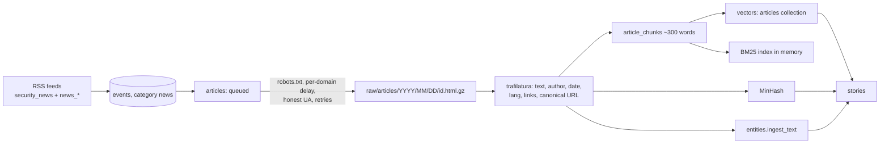

# Overview

The `osinthub/news/` package plugs in through the [extension registry](/architecture/system.md#extensions). It adds 10 feeds, a background article fetcher, chunking and embeddings, story clustering, an `article` search type and the `/api/news` [endpoints](/architecture/api.md#news).

| Module | Role |
|---|---|
| `sources.py` | The research and news feeds, each a batch source with a trust tier and role (newsroom or research); the outlet-to-tier map; the feeds that were skipped and why. |
| `fetcher.py` | Article queue, polite fetching, block detection and storing. Re-extraction from stored HTML. |
| `extract.py` | Main text and metadata (trafilatura), bot-check and paywall markers. |
| `pipeline.py` | Chunks, MinHash, entity hook, embeddings, and the background loops. |
| `stories.py` | Syndication detection, clustering, story rows and LLM summaries. |
| `search.py` | Hybrid article search. |
| `api.py`, `ext.py`, `schema.py` | Endpoints, registration and tables. |

# Feeds

The existing `security_news` source (BleepingComputer, The Hacker News, Krebs, SANS ISC) is unchanged. These were added, each checked on 2026-11-04 with the app's own User-Agent for the feed, robots.txt and an article page ([source docs](/sources/current/index.md)):

| Source id | Outlet | Role | Tier | Every |
|---|---|---|---|---|
| `news_therecord` | The Record | newsroom | B | 20 min |
| `news_securityweek` | SecurityWeek | newsroom | B | 20 min |
| `news_helpnetsecurity` | Help Net Security | newsroom | C | 20 min |
| `news_cyberscoop` | CyberScoop | newsroom | B | 20 min |
| `news_darkreading` | Dark Reading | newsroom | B | 20 min |
| `news_talos` | Cisco Talos | research | B (A on Cisco products) | 2 h |
| `news_unit42` | Unit 42 | research | B (A on Palo Alto products) | 2 h |
| `news_mstic` | Microsoft Threat Intelligence | research | B (A on Microsoft products) | 2 h |
| `news_eset` | ESET Research (WeLiveSecurity) | research | B (A on ESET products) | 2 h |
| `news_elastic` | Elastic Security Labs | research | B (A on Elastic products) | 6 h (the feed is 8 MB) |

Event titles and summaries from every RSS source (these and `security_news`) are stored as plain text: entities left after feedparser's own decoding are decoded at ingest until nothing is left to decode (Dark Reading double-encodes, `&amp;amp;`; SANS ISC summaries carry `&#xd`, `&#x5b;` and `&#x26;#39&#x26;#x3b;`). Only well-formed references are decoded: a named entity needs its `;` (`Q&notes`, `&copy law` and `&pound5` stay as written), a numeric one (`&#39`, `&#xd`) may lack it. Control characters that result become spaces. Events stored before this are fixed by each source's next run (`prepare()` before parsing). Clients escape the text when they show it.

Tiers follow the [trust model](/sources/trust-model.md), per article (`tier`, with the reason in `tier_reason`):

* **B:** newsrooms that report with named sources (The Record, SecurityWeek, CyberScoop, Dark Reading, BleepingComputer, Krebs), and vendor threat-research teams and SANS ISC.
* **A:** a research team writing about a security problem in its own company's products, the "vendor PSIRT" case. `OWNED_PRODUCTS` in `sources.py` maps each publisher to its product families (PAN-OS, GlobalProtect, Prisma Cloud; Exchange Online, Windows, Entra; Cisco IOS XE, ASA, SD-WAN; and so on). An article is A when one of these holds:
  * an owned product sits within six words of a problem term in the headline;
  * an owned product sits within six words of a vulnerability term in the lead's first two sentences;
  * a CVE in the headline or lead belongs to the publisher, according to CISA KEV.

  The publisher's own name ("ESET researchers uncover…"), its team names ("Microsoft Defender Experts"), and a product used as a tool or channel ("with Elastic Defend", "via Microsoft Teams messages") don't count. That gives 2 articles in the current lake; `tests/news/test_tiers.py` covers 11 cases.
* **Marketing:** research-blog posts about the publisher's own products with no threat in the headline ("Elastic Workflows GA") are marked `sponsored` and kept out of stories.
* **C:** outlets that mostly rewrite others' research or run vendor announcements: The Hacker News and Help Net Security.

These were skipped and are listed in the [candidates](/sources/candidates/research-and-news.md):

* **Check Point Research:** AWS WAF challenge (`202`, `x-amzn-waf-action: challenge`).
* **SentinelLabs:** article pages return a 429 "Vercel Security Checkpoint".
* **Securelist:** connection refused.
* **Sophos X-Ops:** timed out.
* **Google Threat Intelligence Group, MSRC:** no working RSS path.

# Fetching

Every news event with a URL gets an `articles` row in state `queued`, including events from before the package existed (backfill on startup and every pass). The fetcher runs every 60 s and never runs while `config.OFFLINE` is set.

* **Identity.** The article id is `sha1(normalised URL)[:16]`. Normalisation lowercases the host, drops `www.`, the fragment, tracking parameters and trailing slashes.
* **User-Agent.** Always `config.USER_AGENT`; never a browser string.
* **robots.txt.** Fetched once per domain per day and cached in memory and in `news_robots`. A 4xx means allowed (RFC 9309); a 5xx or no answer means "retry later". `Crawl-delay` is honoured, capped at 60 s. It is fetched like an article (`_fetch_robots`): redirects are followed by hand, at most 5, and every hop must pass the public-address check before it is requested. A hop to loopback, the LAN, link-local or cloud metadata (or a name that resolves there), a non-http(s) URL or too many redirects make robots.txt **unavailable**, exactly like an unreachable one: nothing is stored, the article is retried later, and the refused hop is never requested, so its body is never read. At most 512 KB of a robots.txt is read.
* **Redirects** are followed by hand, at most 5 hops. Each hop's robots.txt is checked, and its domain's delay applied, before it is requested. A hop into a disallowed path or host is refused (`blocked`, "redirect to … disallowed by robots.txt") without requesting it.
* **Public addresses only, pinned (SSRF and DNS rebinding).** Before each request (article or robots.txt, every hop) the host is resolved once and every answer must be globally routable (`public_ips`; IPv4-mapped and NAT64 forms of internal addresses, multicast and the 6to4 relay range 192.88.99.0/24 count as not public). The request then goes to **those checked addresses**, tried in resolver order until one connects (as a dual-stack connect would), and never to any other (`pinned_request`, as `notify.pinned_target` does): the URL carries the IP, the `Host` header keeps the real name and port, and for HTTPS the TLS server name (SNI) is the real name, so the certificate is still verified against the name. A name that answers public at the check and loopback a moment later never gets a second lookup. The article client keeps no idle connections, so a TLS connection made for one name is never reused for another name on the same address. It also **ignores proxy environment variables** (`HTTPS_PROXY`, `HTTP_PROXY`, `ALL_PROXY`, `NO_PROXY`; `trust_env=False`): a pinned connection must go direct, because a proxy tunnel starts TLS with the pinned IP as the server name (so every HTTPS certificate check would fail) and a proxy would resolve the name again itself, undoing the pin. Feeds and other downloads still honour the proxy variables. Bodies are read through the bounded decoder of [size limits](/data/size-limits.md) (6 MB per article).
* **Rate.** One request at a time per domain, at least 8 s apart. Domains run in parallel, with at most 12 articles per domain per pass.
* **Retries and pauses.** Timeouts, 429 and 5xx back off exponentially (4 min doubling to 6 h, or `Retry-After`). After 5 attempts the article is `failed`. A 429 or 5xx also **pauses the whole domain** for that long: the rest of its queue gets the same `next_attempt` and no further request goes to it in the pass. Articles that robots.txt disallows are still settled from the cached file.
* **Conditional GET and updates.** `ETag` and `Last-Modified` are kept. Articles published in the last 7 days are fetched again 6 h and 48 h after the first fetch (`refetch_stage`, `checked_at`). A `304`, or unchanged text, only records the check. Changed text replaces the stored text, sets `updated_at`, and redoes chunks, embeddings and entities. A re-fetch never downgrades a stored article.
* **Never worked around.** `blocked` with a reason for: 401, 402, 403 and 451; WAF challenge headers; Cloudflare, Imperva, PerimeterX, DataDome and Vercel challenge pages; JSON-LD `isAccessibleForFree: false` or subscriber-only text with little article text; redirects to login or subscribe pages; robots.txt disallow.
* **Storage.** Raw HTML gzipped at `raw/articles/YYYY/MM/DD/<id>.html.gz` (fetch date, path stored relative to the lake). Text and metadata go in `articles`. `POST /api/news/reextract` re-runs extraction from these files with no network.

# Extraction

trafilatura (`favor_precision`, no comments, tables kept) gives the main text, author, date, description and links. Outbound links are kept in `links`. Page furniture is then removed by generic rules plus a few per-site ones (`extract.py`):

* **Generic rules:**
  * short lines that start with or consist of furniture ("Related:", "Read more", share, newsletter, sign-up, webinar, tags, about the author);
  * advert calls to action ("Start your free … scan");
  * runs of two or more lines that are mostly link text;
  * pipe-separated footer navigation;
  * author bios and "learn more about" plugs in the last fifth of the page;
  * everything after a "Related posts", "Diary Archives" or "More from" heading in the last third;
  * a first line that repeats the headline.
* **Per-site rules:**
  * BleepingComputer: inline scan and trial adverts;
  * SecurityWeek: "Related:" lines;
  * SANS ISC: "Diary Archives", comment counts, handler signatures, "PGP Key" footers;
  * Microsoft: related and promotional lists;
  * Unit 42: service plugs;
  * Elastic: legal disclaimers.

Article fields:

* The **title** is the feed's headline, with HTML entities decoded and SANS ISC's `(Sat, Oct 31st)` suffix removed.
* The **published date** is the feed's. If the feed has none, it comes from JSON-LD `datePublished`, then the page.
* The **author** comes from JSON-LD, then `<meta name=author>`, `article:author` and trafilatura. Generic bylines such as "Unit" or "Staff" are rejected, and single-author sites have a default (Krebs on Security: Brian Krebs).
* The **language** comes from a stop-word vote over the text (en, fr, it, es, de, pt), then `<html lang>`. Dark Reading serves its French and Italian translations under `lang="en"`.
* The **canonical URL** comes from `<link rel=canonical>`.
* **Sponsored and promotional posts** get `sponsored` set to the reason:
  * BleepingComputer's "Sponsored and written by" posts;
  * Help Net Security's "Industry News" press releases;
  * webinar titles;
  * sponsor wording in the byline, section or text.

  They stay searchable but are kept out of stories, so they never count as corroboration.

Fewer than 200 characters of text marks the article `failed` (no main text). The SANS Stormcast podcast pages hit this.

# Chunks and embeddings

* **Chunks.** Paragraph-aware chunks of 300 words (about 400 tokens) with 60 words of overlap, each prefixed with the title, in `article_chunks`.
* **Embeddings.** Each chunk is embedded through `osinthub/ai/client.py` and upserted to the `articles` vector collection. The payload holds `article_id`, `source`, `published`, `title`, `chunk`, `tier` and `ts`. The mean chunk vector (normalised) is kept in `article_vecs` for clustering and "similar articles".
* **Incremental.** `embedded_at IS NULL` marks the work left. When the helper is down the pass stops and resumes on its own when it returns; nothing is lost.
* **Entities.** Each fetched article is passed to `entities.ingest_text("article", id, title + text, url, tier)` once (`entities_at`). The call is guarded, so the package works without the entities layer. It runs in its own slow loop because it can call the LLM. If the LLM pass gets no answer for any chunk it sent (the helper is down, times out, returns an HTTP error or an unusable reply), the regex and alias results and the chunks that did answer are stored, and `entities_llm_missed` records the missed pass. Answered chunks are cached, so a retry asks only for the missing ones. While the helper is up, those articles are ingested again so they get actors, victims, sectors and reported claims: fewest misses first, then newest, 10 minutes after a miss. A timeout or error while the helper is up counts in `entities_llm_tries` and each one doubles the wait (20, 40, 80, 160 minutes); an outage does not count. After 6 such tries the article is given up: `entities_llm_missed` is cleared and `entities_llm_tries` stays at 6 as the record, so a text the helper always times out on cannot hold it for 15 minutes a day forever. Re-ingesting only adds what is new. If `ingest_text` raises, the article stays pending, `entities_fails` and `entities_failed_at` record it and it waits with the same backoff, after the fresh articles, so a few failing articles cannot block the rest. A successful ingest clears these counters. A re-fetch or re-extraction that brings new text resets all of them with `entities_at` (`ENTITIES_RESET` in `common.py`), so the new text gets a fresh set of retries even if the old one was given up; an unchanged re-fetch keeps them.

# Stories

New articles are clustered in published order. Articles that are not fetched yet, or can't be, cluster on title plus feed summary.

1. **Syndication and translations.** An article is a copy (`dup_of`) of an earlier one when:
   * both share a canonical URL, ignoring a translation suffix such as Dark Reading's `<slug>-italian`;
   * or the MinHash Jaccard over word 5-shingles is at least 0.5, within 21 days.

   A copy joins the original's story and counts once in `source_count` and `tier_counts`.
2. **Similarity** is computed as follows:
   * The cosine of the two mean embeddings plus 0.5 × the TF-IDF cosine of headline (×3) and lead (120 words). Without embeddings it is the TF-IDF cosine alone.
   * Minus a penalty when both come from the same outlet.
   * Zero for same-outlet series: titles that differ only in dates and version numbers, or share a `Series:` prefix.
3. **Strong keys** come from the headline and lead only. Something mentioned in passing further down is background.
   * **Event keys:**
     * CVE ids;
     * nicknames from the headline: coined vulnerability or campaign names such as PHP2Shell or Log4Shell, and quoted names. A nickname counts double, even when the entities layer types it as malware;
     * proper names in the headline that the body also capitalises mid-sentence;
     * proper names in the first 150 words of the lead (Danfoss, Colruyt), excluding:
       * ordinary words, meaning words the corpus also writes in lower case;
       * places: countries, demonyms, and words after "in" or "from";
       * the outlet's own name;
     * organisation entities and their name tokens, so "Ahold Delhaize" meets "Delhaize";
     * campaign entities.

     Names that more than 12 articles use, and very common names (Google, Microsoft, Android), are dropped.
   * **Actor keys:** actor, malware and tool entities, and names matching them. They say *who*, not *which event*: two ShinyHunters arrests are two events. So they never lower the bar alone, and add weight only next to an event key.
   * **Different countries:** when the headlines name different countries (a Jordanian arrest, a Canadian arrest), shared names don't lower the bar, unless the shared key is a CVE or a nickname.
   * When both articles name more than 4 CVEs (patch round-ups), shared CVEs don't count.
4. **The bar** depends on the keys the two share:

   | Shared keys | Window | With embeddings | Lexical only |
   |---|---|---|---|
   | none | 4 days (21 when one is primary research and the other names that team in its lead) | 0.95 | 0.21 |
   | 1 | 14 days (30 for a CVE) | 0.86 | 0.13 |
   | 2 or more | 14 days (30 for a CVE) | 0.78 | 0.07 |

   Round-ups never merge by similarity: "Weekly Recap", "ThreatsDay", Stormcast, "Threat Intelligence Highlights", and headlines that list three or more organisations with plural incident words ("WorkOS, Northflank, Trigger.dev Disclose Hacks").
5. **Assignment.** Candidate stories are scored two ways:
   * pair by pair, against their articles;
   * against the story as a whole: cosine to the story's centroid (mean embedding of its originals) plus 0.5 × mean lexical cosine, against the lowest bar from the keys shared with any member.

   The article joins the best candidate when it is also close to at least half of that story's original articles (the same bar minus 0.07 / 0.05). This stops chaining. If the best story rejects it, the next is tried; otherwise it starts a story.
6. **Merging.** Incremental clustering can start two stories before a later article shows they are one event. After each pass, a changed story is merged into another within 30 days when an article pair across them clears the bar and each story's articles fit the other.

`POST /api/news/recluster` rebuilds every story. LLM summaries survive: a new story takes the summary of the old story it overlaps most (Jaccard ≥ 0.5). It is kept as is when the members are identical; otherwise it is rewritten once the story has grown by half. When stories merge, an LLM summary is carried over the same way.

Each story row holds:

* `title` and `lead_article`: the earliest readable original.
* `summary`: written by the local LLM for stories with 2 or more articles while the helper is up (`summary_by = 'llm'`), rewritten when the story grows by half. Otherwise it is the lead's dek (`summary_by = 'dek'`).
* `first_seen`, `last_seen`, `article_count`.
* `source_count`, `tier_counts` and `sources`: distinct outlets, copies counted once.
* `top_entities`: from entity mentions, or CVE ids before the entities layer exists.

The "new since" support works through `new_since=` on the story list, and the stored marker `/api/news/marker`.

# Story intelligence

The story detail carries:

* **`iocs[].listed_by`:** the threat lists (Feodo, ThreatFox, URLhaus, SSLBL, Spamhaus DROP and the other netlog lists) that hold the indicator now or held it before, from `indicator_intervals`; an IP inside a listed CIDR and a domain under a listed parent count, our own reported IOCs do not. The story IoC table shows it as a "listed · threatfox" chip: independent corroboration of the article.
* **`timeline`:** the story as it unfolded, each article marked as `first_report`, `corroboration` (a new outlet), `follow_up` (an outlet again) or `copy`.
* **`iocs`:** type, value, first and last seen in the story and globally, outlets, and relationships from claims.
* **`cves`:** CVE enrichment from the lake.

Noise is filtered from the IoC table, from `cves`, and from the News UI's `/api/news/intel` indicators. The filter runs at query time, so existing rows are covered:

* **No evidence:** indicators not found in the stored article text, written plainly or defanged.
* **Version numbers read as IP addresses.** These use the entities extractor's rules:
  * a version cue before the number ("Fixed in 9.16.4.104", "v", "build", "firmware");
  * "and later" or "or earlier" after it;
  * small octets (all ≤ 31) with no IOC context nearby ("Rails 8.0.5.2").
* **Field names** that look like domains (`container.id`, `host.id`).
* **CVE ids** that only occur truncated or as a pattern (`CVE-2026-10961[89]`).
* **Domains described as legitimate services or tools,** including legitimate ones being abused (code hosted on GitHub).
* **Popular, benign domains and URLs** (Tranco top 20k from `<lake>/ref/` through the netlog allowlist), unless a report defangs them or names them in an IOC context.

Mention `offsets` match defanged forms too (`evil[.]com`, `hxxps://`, `[dot]`) and point at the text as written.

CVE enrichment (`/api/news/cves`) joins on the upper-cased CVE id:

* **NVD** (events of kind `cve`): CVSS (the value column, else severity × 10), severity and published date. `nvd_recent` keeps only a 72-hour window of new CVEs; an older CVE takes its CVSS from a CISA advisory when one covers it (`cvss_status: "from CISA advisory"`), else `cvss_status: "not in NVD data"`.
* **CISA KEV** (events of kind `kev`): status, date added, ransomware use and the vulnerability name.
* **EPSS** (the `epss` table, [FIRST EPSS](/sources/current/epss.md), every scored CVE): `epss` (0-1), `epss_percentile` (0-1), `epss_date`, `epss_since` (when the probability last changed), `epss_prev`, and `epss_status`: `ok`, `not scored` or `not loaded`.
* **CISA advisories** (the `advisory_cves` table, [CSAF](/sources/current/cisa_advisories.md)): `advisories: [{id, title, kind, url, cvss, updated}]`, newest first.

`POST /api/news/epss` with `{"ids": [...]}` (at most 10,000) returns the latest EPSS for many CVEs at once, for list panels.

# Search

`search.py` is a hybrid of two rankings:

* **Keyword.** BM25 over chunks, plus title and summary for unfetched articles. The index is built in memory and rebuilt when articles change.
* **Vector.** The query embedding against the chunk collection.

Results are grouped per article; the best chunk is the snippet. `collapse=story` keeps the best article per story and reports `story_hits`. The score is the cosine plus 0.25 × the normalised BM25, the same fusion as `osinthub/search.py`, so `article` results rank sensibly next to `cve` and `event` ones in `/api/search/semantic`. Without embeddings it is BM25 alone. Filters: `since`, `until`, `sources`, `tiers`.

# Watchlists

The watchlist is now the app-wide followed list, [My stack](/architecture/my-stack.md) (`osinthub/stack.py`). The same `settings` key `news.watchlist` holds `{entities: [...], keywords: [...], stack: [{vendor, product}]}`; `/api/stack` and the old `/api/news/watchlist` endpoints edit it.

* `GET /api/news/watchlist` returns the list plus `names` (display names of followed entities), `equivalents` (each followed id and the ids merged with it) and `count`.
* `PUT /api/news/watchlist` replaces `entities` and `keywords` as in v1.0; `stack` is replaced only when the body sends it, so an old client never drops the vendors and products followed elsewhere. Entities merged into one already in the list are kept once; keywords are de-duplicated ignoring case.
* `GET /api/news/watchlist/digest?since=` returns stories with articles published after `since` that mention one of the watched entities (through `mentions`, or a story's `top_entities`, both read through the user's merges), a keyword (in the title, dek or text), or a followed vendor or product (whole-word match with the [false-positive guards](/architecture/my-stack.md#matching)). Each story carries `matched` (keys: the entity id as followed, `keyword:<word>`, `stack:<label>`) and `matched_names` (key → display name).

# Tables

| Table | Key columns |
|---|---|
| `articles` | `id`, `url`, `source` (outlet), `source_id`, `event_id`, `title`, `published`, `fetched_at`, `text`, `html_path`, `story_id`, `lang`, `status` (`queued`, `ok`, `blocked`, `failed`, `skipped`), `reason`, `tier`, `tier_reason`, `role`, `dek`, `author`, `canonical_url`, `links[]`, `http_status`, `etag`, `last_modified`, `attempts`, `next_attempt`, `minhash[]`, `dup_of`, `sponsored`, `checked_at`, `refetch_stage`, `updated_at`, `chunks`, `embedded_at`, `clustered_at`, `entities_at`, `entities_llm_missed`, `entities_llm_tries`, `entities_fails`, `entities_failed_at` |
| `article_chunks` | `article_id`, `idx`, `text` |
| `article_vecs` | `article_id`, `vec` (mean chunk embedding) |
| `stories` | `id`, `title`, `summary`, `summary_by`, `lead_article`, `first_seen`, `last_seen`, `article_count`, `source_count`, `tier_counts`, `sources[]`, `top_entities` |
| `news_robots` | `domain`, `status`, `body`, `fetched_at` |

# Measurement

`tests/eval/score_news.py` uses only the HTTP API, so it runs offline. The critic's independent scorer and probes are in `tests/eval/critic/`. Unit tests on temporary lakes are in `tests/news/`: fetcher politeness against mock sites, clustering, extraction and the API.

Measured 2026-11-05, offline, on an internal-disk copy of the scratch lake (353 articles from 14 outlets), with the AI helper up, DuckDB vectors, and the entities extension disabled for stable runs (existing mentions used):

| Measure | Result |
|---|---|
| Fetch success | 0.989 overall. 13 outlets at 1.0; SANS ISC 7/11, because the 4 Stormcast podcast pages have no article text. 0 blocked. |
| Extraction, 20 sampled articles (`tests/eval/out/news_extraction_sample.json`) | Title matches the page 1.0, date matches the page 1.0, no boilerplate 0.95. The one miss is a 211-character SANS diary under the 400-character floor. |
| Critic extraction audit, 40 articles | 0 author or date mismatches with the page |
| Story pairs, builder's labels | 1.0 (30/30) |
| Story pairs, critic round 1 labels | 0.967 (29/30). The miss is Talos vs Krebs on Patch Tuesday (one shared CVE, below the bar). |
| Story pairs, critic round 2 labels | 1.0 |
| Story pairs, critic round 3 labels | 1.0 (same-event recall 1.0, different-event specificity 1.0); round 3 vague-query search 0.933 hybrid, 0.867 keyword |
| Search | Builder's queries: recall@5 0.967. Critic round 1: 0.987 hybrid, 0.931 keyword. Critic round 2: 1.0 hybrid and keyword. |
| Tiers | 2 A (Unit 42 on PAN-OS, Talos on Cisco SD-WAN), 280 B, 71 C |
| Critic politeness probe | Honest UA only; robots disallow honoured; the first 429 pauses the whole domain; 0 requests offline. Redirect-hop robots checks and conditional GET are covered by `tests/news/test_fetcher_polite.py`. |

Known limits:

* Patch Tuesday coverage shares only a CVE or two between a vendor round-up and a news story, so it can stay split.
* Thresholds were set on this corpus; each critic round uses fresh labels.
